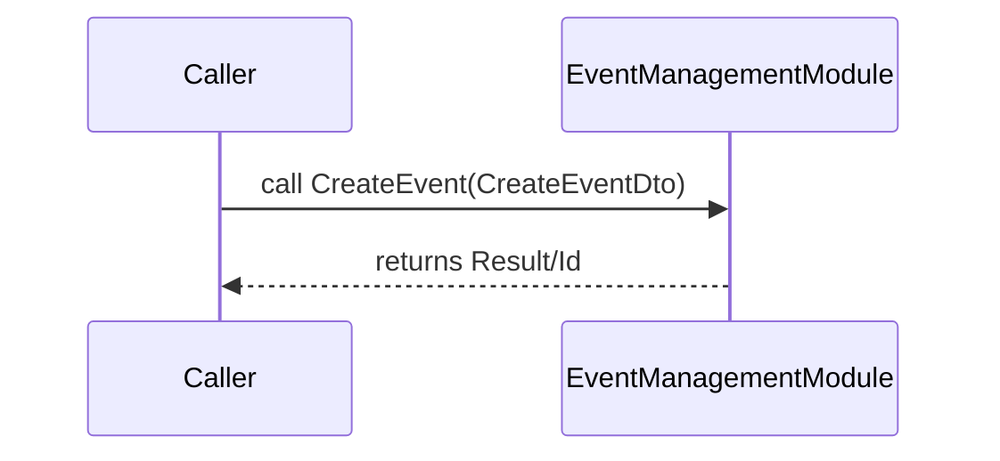
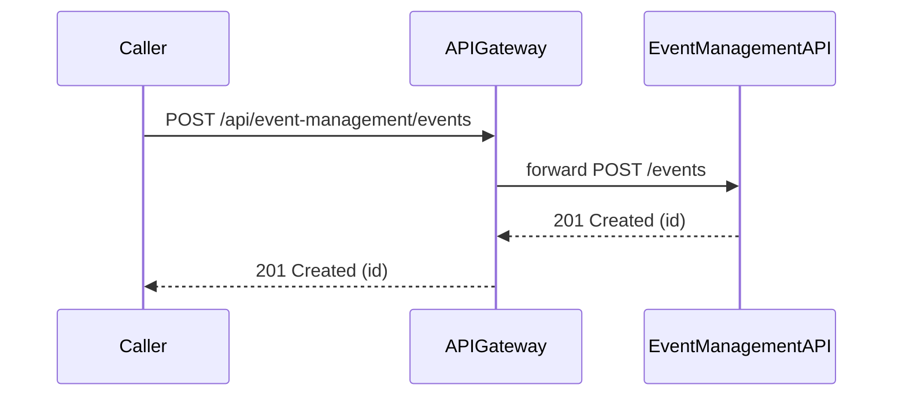
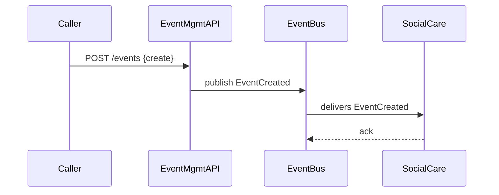

# Integrating with the EventManagement module

This document explains two main integration approaches with the `EventManagement` capability in the Processity repository:

- Assembly (in-process) integration — referencing and calling the module directly from your codebase.
- API (out-of-process) integration — calling EventManagement over HTTP (via API Gateway or direct service endpoint).

It also outlines pros/cons, concrete examples, security & testing advice, and a recommendation for most scenarios.

---

## Quick context

The `EventManagement` module is located under `Processity.Backend/EventManagement` and contains:
- `src/EventManagement/` — the implementation project
- `src/EventManagement.Models/` — DTOs / models for the module
- `test/` folders with integration and unit tests

You can integrate with EventManagement by either referencing the module (assembly) or by talking to it over HTTP. Choose based on deployment, coupling, operational boundaries and team ownership.

---

## 1) Assembly (in-process) integration

Description
- Add a project reference to the `EventManagement` implementation (or to an exported `EventManagement.Models`/contract assembly) and call its public APIs directly in-process.
- This is typically used when the feature is considered a logical module of the same app (monolith) and will be deployed together.

When to use
- You're extending the monolith (the same deployment), not a separately deployed microservice.
- You need full access to internal APIs, value objects, EF Core DbContexts, and domain models for complex orchestration.
- Performance-critical code where method-call latency is important.

Pros
- Zero network overhead (direct method calls).
- Reuse of internal domain types and value objects; less mapping/DTO work.
- Easy to call internal functions, share DbContext transactions (if intentional), and reuse code.

Cons / Risks
- Tight coupling between modules; changes in EventManagement may force rebuilds and coordinated deploys.
- Harder to scale independently — the monolith grows larger.
- Potential for accidentally sharing internal DbContexts or bypassing service boundaries and invariants.
- Can create circular dependencies if not structured with clear contracts.

Example (csproj + usage)

1. Add project reference in your service's .csproj:

```xml
<ProjectReference Include="..\EventManagement\src\EventManagement\EventManagement.csproj" />
```

2. At runtime, inject a public service or interface exposed by EventManagement. Prefer referencing a public contract assembly (`EventManagement.Models` or an `IEventManagementModule`) rather than internal types.

```csharp
// Program.cs or Startup.cs
builder.Services.AddTransient<IEventManagementFacade, EventManagementFacade>();

// In your code
public class MyService
{
    private readonly IEventManagementFacade _events;

    public MyService(IEventManagementFacade events)
    {
        _events = events;
    }

    public Task CreateEventAsync(CreateEventDto dto)
    {
        return _events.CreateEventAsync(dto);
    }
}
```

Guidelines to keep this safe
- Only reference a stable `EventManagement.Contracts` or `EventManagement.Models` assembly (DTOs and interfaces) to avoid tight coupling to internal implementation.
- Avoid sharing DbContext instances across modules; prefer repository/service methods that encapsulate persistence logic.
- Keep public surface small and well-documented.
- Use feature flags or module registration (DI) to optionally enable/disable the assembly integration for different deployments.

Mermaid sequence (assembly)



---

## 2) API (out-of-process) integration

Description
- EventManagement runs as an independent host/service with HTTP APIs. Integrating systems call it over HTTP via the API Gateway or directly to the service endpoint.
- Use NSwag/OpenAPI-generated clients for typed calls or hand-rolled HTTP clients.

When to use
- Team/service boundary; EventManagement owned by another team and deploys independently.
- Need clear isolation, versioning and independent scaling.
- Preference for networked, officially versioned contracts.

Pros
- Clear service boundary; independent deployment and scaling.
- Language-agnostic integration surface (OpenAPI).
- Easier to monitor and enforce API and auth boundaries.

Cons
- Network latency and partial failure modes.
- Needs API versioning, contract management and client generation.
- More mapping code (convert between client DTOs and your domain models).

Example (HTTP client via typed generated client / HttpClientFactory)

1. Generate a client from EventManagement OpenAPI (repo already has `nswag.json` files; use NSwag to generate a typed client).
2. Register the typed client:

```csharp
// Program.cs
builder.Services.AddHttpClient<IEventManagementApiClient, EventManagementApiClient>(client =>
{
    client.BaseAddress = new Uri("https://event-mgmt.internal.api/");
});

// Use the client
public class MyService
{
    private readonly IEventManagementApiClient _client;

    public MyService(IEventManagementApiClient client)
    {
        _client = client;
    }

    public async Task<Guid> CreateEventAsync(CreateEventDto dto)
    {
        var response = await _client.CreateEventAsync(dto);
        return response.Id; // depends on your OpenAPI shape
    }
}
```

Mermaid sequence (API)



Best practices for API integration
- Use OpenAPI/NSwag to generate strongly typed client libraries and keep them versioned along with the API.
- Implement retries with exponential backoff for idempotent operations.
- Add request idempotency where appropriate (client-generated idempotency keys or server-side dedupe).
- Use API Gateway for authentication (token exchange, JWT, scopes) and rate limiting.
- Document API versions and maintain backward-compatible changes where feasible.

---

## 3) (Recommended) Combine API + Event Bus for decoupling

- For most integrations where EventManagement produces domain events that other modules react to, prefer the Event Bus (CAP or messaging) for asynchronous communication.
- Use API calls for command-style operations (create, update) and publish events for domain state changes. That allows other services to subscribe without tight coupling.

Mermaid sequence (Command -> Event Bus -> Subscriber)



---

## Contracts, DTOs and Shared Models

- If you choose assembly integration, prefer referencing `EventManagement.Models` (public DTOs) to reduce leakage of internal types.
- For API integration, rely on OpenAPI and generated clients. Keep DTOs stable and add versioned endpoints when changing shapes.
- Consider adding a small `Contracts` package (internal nuget or repository project) that contains only the canonical DTOs used by multiple modules.

---

## Security

- Assembly integration: control access via DI and API surface; avoid exposing dangerous internal operations.
- API integration: enforce auth & scopes on endpoints. Examples:
  - Use OAuth2/JWT tokens with scopes like `eventmanagement.write` and `eventmanagement.read`.
  - Validate tokens at API Gateway and forward the principal or a service-to-service token.
  - Consider mTLS for internal service-to-service traffic in production.

---

## Testing and CI

- Assembly integration:
  - Use unit tests that construct the EventManagement module service objects (or use the `TestWebApplicationFactory` for in-memory integration tests).
  - Prefer creating a `FakeEventManagement` or interface-based mock for unit tests to avoid DB or heavy dependencies.

- API integration:
  - Add contract tests (consumer-driven) and run against a staging environment.
  - Use integration tests that spin up the EventManagement host (or a TestServer) and call the real endpoints.
  - Add health checks and contract verifications in your CI pipeline.

---

## Data & Migrations

- Assembly integration can result in shared DbContext usage; be explicit if you need cross-context transactions.
- API integration keeps DB ownership with EventManagement and avoids direct DB access from consumers.

---

## Decision checklist (summary)

- If you control the same deployable unit (monolith) and need deep domain access → Assembly integration (but prefer stable contract package).
- If you need independent deployment, team boundaries, or language-independent access → API integration + Event Bus.
- If you expect many subscribers to domain events → use Event Bus for async delivery.

---

## Example migration path

1. Start with API integration and well-documented OpenAPI contracts.
2. When code becomes tightly coupled and performance demands require it, consider swapping a performance-critical path to an assembly reference while maintaining the API for other consumers.
3. Use feature flags to toggle assembly vs API behavior during rollout.

---

## Appendix: checklist for implementing API integration

- [ ] Generate OpenAPI client with NSwag and check into `src/clients` or publish as package
- [ ] Add typed HttpClient registration and a small adapter that maps DTO -> domain
- [ ] Implement retries + idempotency + circuit breakers for resilience
- [ ] Add contract/integration tests that run in CI
- [ ] Document required auth scopes and sample curl requests

---

If you want, I can:
- Produce a concrete `EventManagement.Contracts` project skeleton we can publish and reference.
- Generate a sample NSwag-based typed client and register it with `HttpClientFactory` (I can add the generated client files).
- Create a small example consumer in the repo that demonstrates both assembly and API integration approaches.

Which follow-up would you like me to implement next? (I can add the contracts project scaffold or a sample typed client.)
