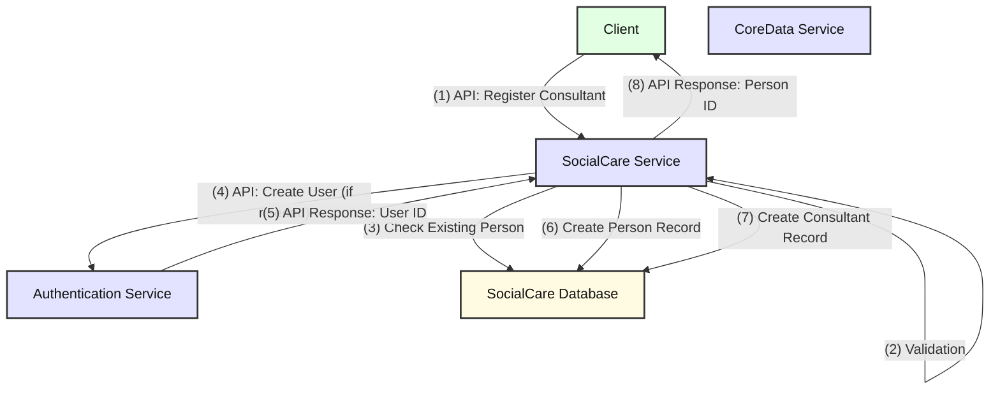
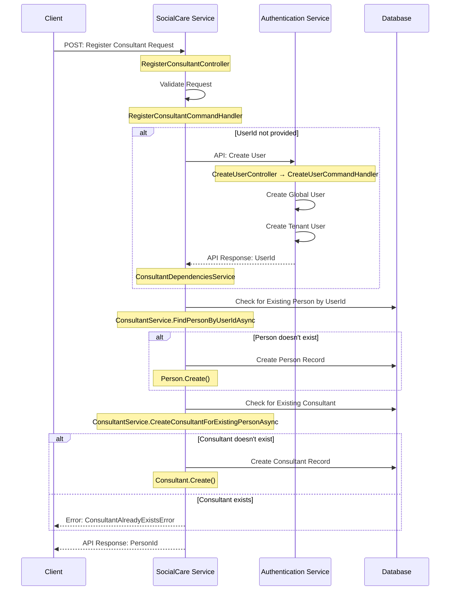

# Register Consultant Feature Documentation

## Overview

The Register Consultant Feature is responsible for creating new consultant records in the Social Care system. This includes creating user accounts in the Authentication Service, establishing person records, and linking them to consultant roles. The system spans multiple services and handles both new user creation and existing user association scenarios.

## System Architecture

The Register Consultant Feature spans multiple microservices:

1. **SocialCare Service** - Handles consultant registration requests and manages person/consultant entities
2. **Authentication Service** - Creates and manages user accounts and authentication
3. **CoreData Service** - Manages contact information and provides centralized person data

## Key Features

### 1. Register New Consultant

Allows registration of new consultants in the system. The process can handle two scenarios:

- Creating a new user account and associating it with a consultant
- Associating an existing user account with a new consultant role

### 2. User Account Management

Integrates with the Authentication Service to create user accounts when needed, ensuring proper authentication and authorization setup.

### 3. Contact Data Synchronization

Maintains cached contact information from CoreData while preserving the authoritative contact reference.

## Data Flow

The following diagram illustrates the data flow between components:



If the Mermaid diagram isn't rendering properly, here's a simplified text representation:

```text
API Calls:               Internal Operations:
---------------------    ---------------------
Client → SocialCare      SocialCare → Database
SocialCare → Auth

Flow:
1. Client → SocialCare                 [API Call] Register Consultant Request
2. SocialCare → SocialCare             [Internal] Validate Request
3. SocialCare → Database               [Internal] Check for Existing Person
4. SocialCare → Authentication         [API Call] Create User (if needed)
5. Authentication → SocialCare         [API Response] Return User ID
6. SocialCare → Database               [Internal] Create Person Record
7. SocialCare → Database               [Internal] Create Consultant Record
8. SocialCare → Client                 [API Response] Return Person ID
```

## Component Interaction

### Registration Flow

1. **Client** calls the `RegisterConsultantController` in SocialCare Service
2. `RegisterConsultantCommandHandler` processes and validates the request
3. If no UserId is provided, `ConsultantDependenciesService` calls Authentication Service to create a new user
4. `ConsultantService` checks for existing person records by UserId
5. If no person exists, a new Person entity is created and stored
6. A new Consultant entity is created and linked to the Person
7. The PersonId is returned to the client

### User Creation Flow (when needed)

1. `ConsultantDependenciesService.CreateUserForConsultantAsync` is called
2. A `CreateUserRequest` is prepared with contact details
3. The Authentication Service `CreateUserController` is called via HTTP API
4. `CreateUserCommandHandler` in Authentication Service processes the request
5. Both global and tenant-specific user records are created
6. The new UserId is returned to SocialCare Service

## Data Model

### Key Entities

#### Person

```text
- Id (PersonId)
- FirstName (string)
- LastName (string)
- FullName (computed property)
- ContactId (ContactId) - Reference to CoreData contact
- UserId (UserId?) - Reference to Authentication user
- PrimaryEmail (string) - Cached from CoreData
- PrimaryPhoneNumber (string?) - Cached from CoreData
- ContactDataLastSynced (DateTime)
- Identity (IdentityProfile)
```

#### Consultant

```text
- Id (PersonId) - Same as Person.Id
- PersonId (PersonId) - Foreign key to Person
```

### Request/Response Models

#### RegisterConsultantRequest

```text
- ContactId (ContactId)
- UserId (UserId?) - Optional, if associating existing user
- Email (string)
- FirstName (string)
- LastName (string)
- Phone (string?)
```

#### CreateUserRequest (Authentication Service)

```text
- Email (string)
- FirstName (string)
- LastName (string)
- Phone (string?)
- ContactId (ContactId)
```

## Security and Multi-tenancy Considerations

The system handles multi-tenancy and security through several mechanisms:

1. **Authentication Context**: The original authentication context is preserved when calling external services
2. **Tenant Isolation**: User creation in Authentication Service respects tenant boundaries
3. **Authorization**: Controller endpoints require proper authorization via `[Authorize]` attribute
4. **Strongly Typed IDs**: All entity identifiers use strongly typed value objects for type safety

## Configuration Requirements

### SocialCare Service

```json
{
  "Services": {
    "AuthenticationService": {
      "BaseUrl": "https://authentication-service-url"
    }
  },
  "Authentication": {
    "Cookie": {
      "CookieName": ".AUTH"
    }
  }
}
```

### Authentication Service

The Authentication Service must be configured to handle internal API calls and support both global and tenant-specific user creation.

## Error Handling

The system implements comprehensive error handling at multiple levels:

### Validation Errors

- Request validation occurs before any external service calls
- Input validation errors are returned immediately with appropriate error codes

### Business Logic Errors

- `ConsultantAlreadyExistsError` (SC-PM-RC-505/506) - When attempting to register a consultant that already exists
- `CreateUserFailedError` - When user creation in Authentication Service fails
- `CreatePersonFailedError` - When person creation fails
- `CreateConsultantFailedError` (SC-PM-RC-502) - When consultant creation fails

### Service Integration Errors

- HTTP client errors when calling Authentication Service
- Database transaction failures
- Authentication context propagation issues

## API Endpoints

### Register Consultant

```text
POST /api/v1.0/social-care/api/persons/Consultant
```

**Request Body:**

```json
{
  "contactId": "guid",
  "userId": "guid (optional)",
  "email": "string",
  "firstName": "string",
  "lastName": "string",
  "phone": "string (optional)"
}
```

**Response:**

```json
{
  "value": "person-id-guid",
  "isSuccess": true
}
```

**Status Codes:**

- `201 Created` - Consultant successfully registered
- `400 Bad Request` - Validation errors or business rule violations

## Sequence Diagram

The following diagram illustrates the sequence of interactions between components:



If the Mermaid diagram isn't rendering properly, here's a simplified text representation:

```text
Client              SocialCare Service           Authentication Service      Database
  |                         |                           |                      |
  | Register Consultant     |                           |                      |
  |------------------------>|                           |                      |
  |                         | Validate Request          |                      |
  |                         |---------------------->    |                      |
  |                         |                           |                      |
  |                         | Create User (if needed)   |                      |
  |                         |-------------------------->|                      |
  |                         |<--------------------------|                      |
  |                         | Return UserId             |                      |
  |                         |                           |                      |
  |                         | Check Existing Person     |                      |
  |                         |------------------------------------->           |
  |                         |<-------------------------------------|           |
  |                         |                           |                      |
  |                         | Create Person (if needed) |                      |
  |                         |------------------------------------->           |
  |                         |                           |                      |
  |                         | Create Consultant         |                      |
  |                         |------------------------------------->           |
  |                         |                           |                      |
  |<------------------------|                           |                      |
  | Return PersonId         |                           |                      |
```

The sequence can be summarized as follows:

1. Client sends register consultant request to SocialCare Service
2. SocialCare validates the request using command validation
3. If no UserId provided, SocialCare calls Authentication Service to create a new user
4. Authentication Service creates both global and tenant-specific user records
5. SocialCare checks for existing person by UserId
6. If no person exists, SocialCare creates a new Person record
7. SocialCare checks for existing consultant and creates new Consultant if needed
8. SocialCare returns the PersonId to the client

## Service Dependencies

### ConsultantService

- **IPersonRepository**: Manages person entity persistence and retrieval
- **IConsultantRepository**: Manages consultant entity persistence and retrieval

### ConsultantDependenciesService

- **IUserApiClient**: HTTP client for Authentication Service integration
- **IAuthenticationContextProvider**: Provides current user authentication context
- **IConfiguration**: Access to service configuration settings

## Best Practices

1. **Validation First**: Always validate requests before making external service calls
2. **Idempotency**: Design operations to be safe when called multiple times
3. **Error Propagation**: Properly propagate and categorize errors from external services
4. **Authentication Context**: Preserve authentication context across service boundaries
5. **Strongly Typed IDs**: Use value objects for all entity identifiers
6. **Manual Mapping**: Implement explicit mapping between DTOs and entities
7. **Async/Await**: Use async patterns consistently for all I/O operations

## Common Issues and Troubleshooting

### User Creation Failures

- **Symptom**: CreateUserFailedError returned
- **Causes**: Authentication Service unavailable, validation errors, duplicate users
- **Resolution**: Check Authentication Service connectivity and user data uniqueness

### Consultant Already Exists

- **Symptom**: ConsultantAlreadyExistsError (SC-PM-RC-505/506)
- **Causes**: Attempting to register a consultant for a user who already has consultant role
- **Resolution**: Check existing consultant records or use update operations instead

### Authentication Context Issues

- **Symptom**: Unauthorized errors when calling Authentication Service
- **Causes**: Missing or invalid authentication context, expired tokens
- **Resolution**: Verify authentication context propagation and token validity

### Database Transaction Failures

- **Symptom**: CreatePersonFailedError or CreateConsultantFailedError
- **Causes**: Database connectivity, constraint violations, concurrent modifications
- **Resolution**: Check database connectivity, review entity relationships, implement retry logic

## Future Enhancements

1. **Event-Driven Updates**: Implement domain events for consultant registration
2. **Bulk Registration**: Support for registering multiple consultants
3. **Profile Validation**: Enhanced validation against CoreData contact information
4. **Audit Trail**: Comprehensive audit logging for consultant registration activities
5. **Role Management**: Integration with more granular role and permission systems
