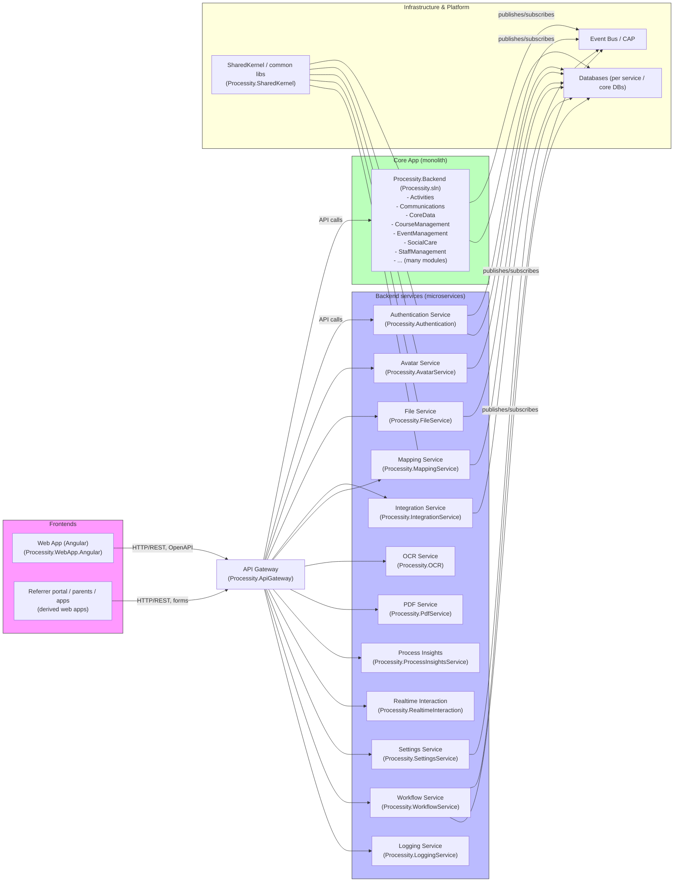

# Processity — Architecture Overview

This document gives a high-level overview of the main components in the Processity workspace: the monolithic Core app (core modules), independent backend services, frontends, and shared infrastructure. It includes a Mermaid diagram to visualise the relationships.

## Purpose
- Provide a concise map of where capabilities live (module vs service vs frontend).
- Help new engineers orient themselves when navigating the repository and planning changes.

---

## Mermaid diagram (high-level)

---

## Component descriptions

### Frontends
- Processity.WebApp.Angular
  - Main Angular monorepo containing the public web app and sub-apps (referrer portal, parents app, instructor views, etc.).
  - Uses auto-generated API clients (NSwag) for communication with backend APIs.

### API Gateway
- Processity.ApiGateway
  - Central gateway that routes requests from frontends to the Core app and individual services.
  - House simple orchestration controllers and cross-cutting middleware (auth header extraction, text converters, operation name generators).

### Core monolith (Processity.Backend)
- A solution with many modules (modules are logically separated under the `Processity.Backend` tree):
  - Activities, Communications, CoreData, CourseManagement, EventManagement, SocialCare, StaffManagement, RuleEngine, Sales, etc.
  - This is where the majority of domain code and many application endpoints live.
  - SharedKernel contains common models, results types and utilities consumed across services and the core app.

### Backend services
- Individual services that implement specialized capabilities, typically with their own host project and DB context. Examples:
  - Authentication (Auth)
  - Avatar Service
  - File Service
  - Integration Service
  - Mapping Service
  - OCR Service
  - PDF Service
  - Process Insights
  - Realtime Interaction
  - Settings Service
  - Workflow Service
  - Logging Service
- These services communicate via APIs and the Event Bus and use the SharedKernel types and DTOs where appropriate.

### Event Bus & Infrastructure
- Event Bus (CAP / messaging layer) is used for async communication (domain events, integration events, decoupled workflows).
- Databases: each service and the monolith have their own DB schemas/migrations (see `migration/` folders in each project for details).
- SharedKernel provides typed ids, results models, auth contracts and common value objects.

---

## How requests flow (typical scenarios)
- Frontend (Angular) → API Gateway → Core App (or Service) → Service DB
  - Example: a form submission from the referrer portal flows into API Gateway then into the Core `Communications` module which may publish events for SocialCare.

- Backend-to-backend async: Core/Services publish integration events to EventBus → subscribers (other services) process them.
  - Example: Core publishes a "BookingRequestCreated" event → SocialCare or Workflow Service picks it up.

- Integration Service and Mapping Service are used for heavy integrations and mapping rules.

---

## Repository layout (selected folders)
- Processity.Backend/ — the monolithic backend with many domain modules and features.
- Processity.ApiGateway/ — gateway project.
- Processity.Authentication/ — auth service.
- Processity.<ServiceName>/ — independent service projects (AvatarService, FileService, OCR, PdfService, WorkflowService, etc.).
- Processity.WebApp.Angular/ — frontend monorepo.
- Processity.EventBus/ — event bus helpers and shared event models.
- migration/ folders in services — DB migrations for each service.

---

## Deployment notes (high level)
- Each service has its `Host` project (a small web host) and a Docker configuration (see `.docker` folders under service hosts).
- The monolith (`Processity.Backend`) is usually deployed as a single app with its own DB; services are individually deployable and have their own DBs and migrations.
- The API Gateway fronts all service endpoints and provides centralized cross-cutting behaviours (auth, API versioning, routing).

---

## Recommended next steps / improvements
- Add a per-service sequence diagram for critical flows (eg. BookingRequest creation → SocialCare → Workflow).
- Expand the Mermaid diagram into multiple levels (deployment view, sequence flows, data flows).
- Maintain and publish a living architecture doc with a diagram exported to PNG/SVG for non-developer stakeholders.
- Consider documenting event names and payload contracts in the EventBus section for easier integration work.

---

## Quick references
- Top-level monolith: `Processity.Backend/Processity.sln`
- API gateway: `Processity.ApiGateway/`
- Frontend: `Processity.WebApp.Angular/`
- Services: `Processity.Authentication/`, `Processity.FileService/`, `Processity.AvatarService/`, `Processity.OCR/`, `Processity.PdfService/`, `Processity.WorkflowService/`, `Processity.SettingsService/`, etc.

*Generated on:* <!--DATE--> 

