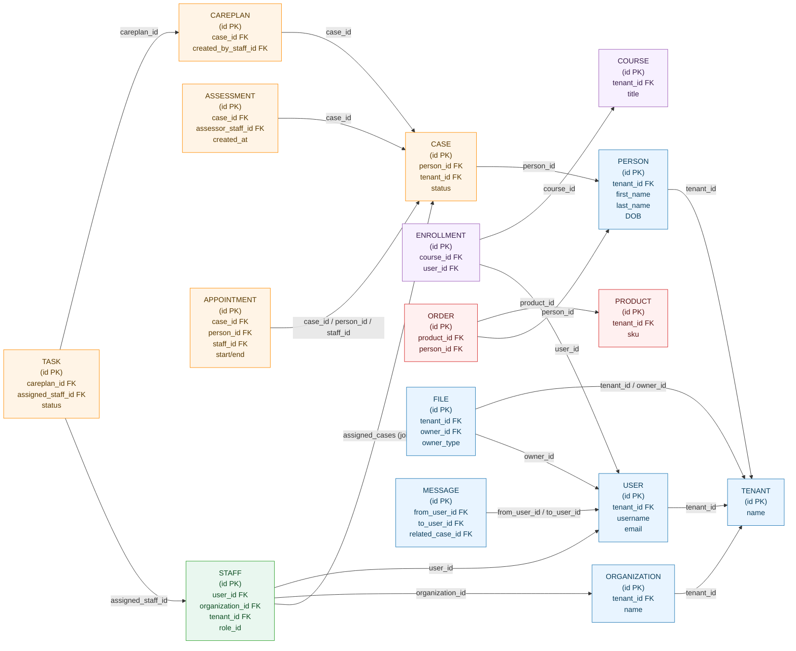
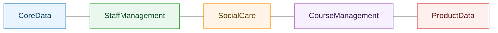
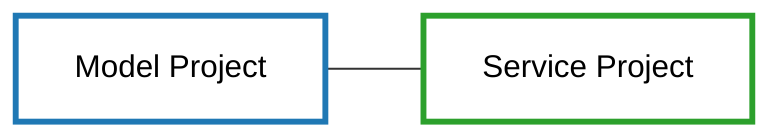
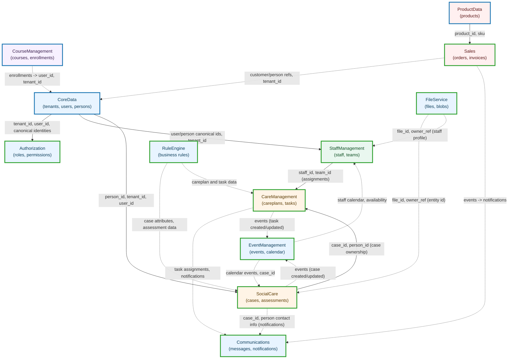

# Backend Data Model Relationships

This document describes the high-level data model relationships in the `Processity.Backend` project and provides Mermaid diagrams to visualize the core entity relationships (ERD) and module dependencies (tight and loose).

**Scope & approach**

- This is a conceptual, cross-module overview intended to help engineers understand how data flows between primary domains (CoreData, SocialCare, CareManagement, StaffManagement, CourseManagement, ProductData, Communications, EventManagement, Authorization, RuleEngine, etc.).
- The ERD shows core entities and key foreign-key relationships used across the backend modules.
- The dependency graph uses solid arrows for _tight_ (strong, frequently accessed/owned) dependencies and dashed arrows for _loose_ (integration / optional / eventual consistency) dependencies.

---

## Canonical core entities (summary)

- **Tenant**: multi-tenant boundary; many entities have a `tenant_id`.
- **User**: authentication/account record mapped to staff or external users.
- **Person**: domain person (service user / citizen / client) and demographic data.
- **Organization**: provider organisations, teams, employers.
- **Staff**: employees, workers, with links to `User` and `Organization`.
- **Case**: social care case record that references `Person` and assigned `Staff`.
- **Assessment**: assessment records tied to a `Case` or `Person`.
- **Appointment**: scheduled meeting tied to `Case`, `Person`, `Staff`.
- **CarePlan**: a plan attached to a `Case` and composed of `Tasks`.
- **Task**: actionable items, often assigned to `Staff` or `Teams`.
- **Course**: training or course objects with `Enrollment` records.
- **Product/Order**: product catalog and order/transaction records (Sales/ProductData).
- **File**: stored file metadata managed by FileService.
- **Message/Communication**: communication records (emails, SMS, in-app messages).

These canonical entities are referenced across multiple modules in the solution. Below we present a compact ERD and then a module dependency diagram.

---

## ERD

The ERD below is a simplified, visual representation using colored boxes to show which module each entity belongs to. Each node lists the primary key and the key foreign key attributes used for cross-module relationships.

---

**Legend (module colors used in ERD)**

**Legend (project types in dependency graph)**

## Module Dependency Graph

The diagram below replaces the previous "Tight"/"Loose" labels with solid (tight/ownership) and dashed (loose/integration) edges. Each edge is annotated with the specific attributes or data flows that cause the dependency.

### How to read the dependency graph

- Core modules like `CoreData`, `Authorization`, `StaffManagement`, and `SocialCare` are tightly coupled because they own canonical records (users, tenants, persons, staff) and are referenced by many downstream modules.
- Service integrations, notifications, file storage and rule evaluation are intentionally looser — they often rely on events or reference IDs rather than owning the canonical data.

---

## Practical notes & recommendations

- Treat `CoreData` entities as canonical — avoid duplicating core identity data across subsystems.
- Use event-driven patterns (EventBus) for loose integrations to keep strong ownership boundaries clear and reduce synchronous coupling.
- Where a module must reference another module's data (e.g., `CareManagement` referencing `Staff`), prefer FK references to `CoreData` IDs for integrity, and use denormalized snapshots for read performance when needed.
- Document any module-specific extensions to the canonical entities inside that module's folder (e.g., `SocialCare/src` should document `Case` schema additions).

---

If you'd like, I can:

- generate a more detailed ERD for a specific module (e.g., `SocialCare`),
- extract actual DB schema definitions from the repository and produce a physical ERD, or
- add cross-reference tables and sample queries showing how modules join on canonical entities.

Tell me which next step you'd prefer.
