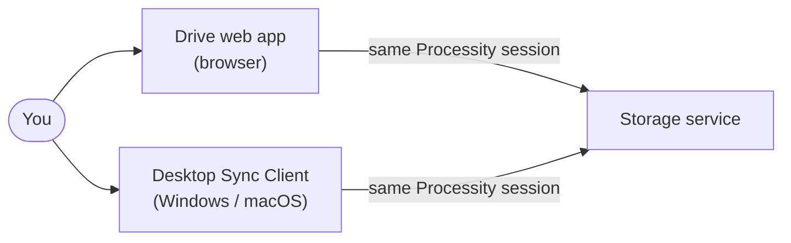
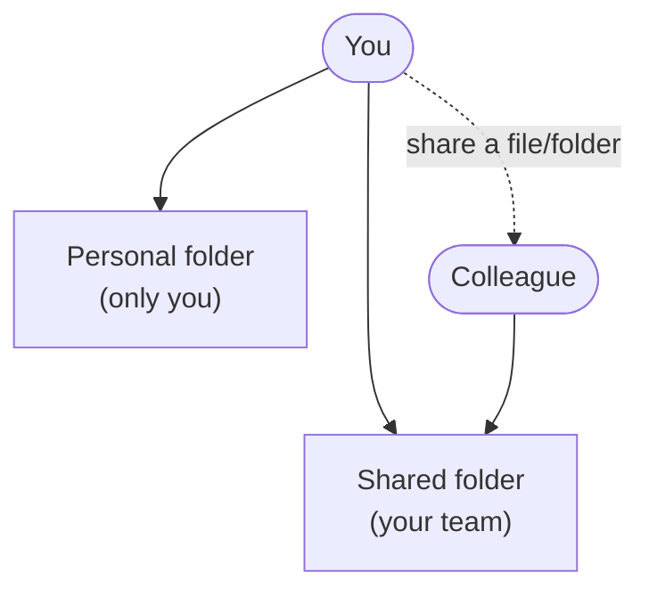
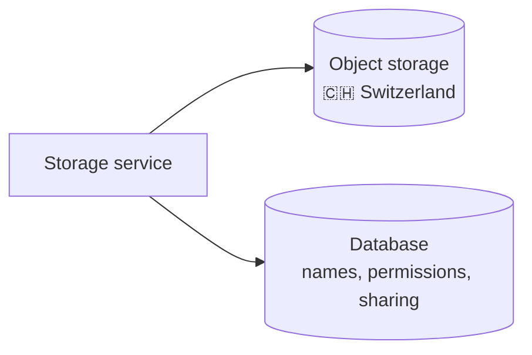

# Processity Drive

## What it is

Processity Drive is secure file storage and sharing, built into the
Processity platform. It works like other cloud drives you may already
know: store files and folders, share them with colleagues, edit Office
documents in the browser, and keep a local folder on your computer in
sync automatically.

## Components

Drive has three parts that work together:

- **Drive web app** — browse, upload, share, and edit files directly in
  your browser, from any device.
- **Desktop Sync Client** ("Processity Drive" app for Windows and macOS) —
  keeps a folder on your computer automatically in sync with your files
  in Drive, the same way OneDrive or Google Drive desktop apps do. Supports
  more than one Processity account at once, if you work across multiple
  tenants.
- **Storage service** — the backend that stores and organizes every file
  and folder, and connects files to the records they belong to elsewhere
  in Processity (e.g. a document attached to a Planning task or an
  ImmoBroker listing).

## How they interact

The web app and the desktop Sync Client both talk to the same storage
service, through the same secure, already-logged-in Processity session —
there's no separate Drive account or password to manage. Changes made in
one place (uploading a file in the browser, editing it locally on your
computer) show up in the other automatically.

Office documents can also be opened and edited directly in the browser
without downloading them first.

## Folders & sharing

Every user gets a personal folder for their own files, plus shared
folders for files a team works on together. Individual files and folders
can also be shared directly with specific colleagues, with access
revocable at any time.

## Security

- **Tenant separation** — every customer's data is logically isolated
  from every other customer's. There is no shared data pool between
  tenants at any layer.
- **Encrypted in transit** — every connection, from the browser, the
  desktop app, and between Processity's own services, uses HTTPS.
- **One login for everything** — Drive uses the same Processity account
  you already sign in with elsewhere on the platform, not a separate
  Drive password. Your session is carried in a browser cookie that
  JavaScript can never read directly (`HttpOnly`), reducing the impact of
  a compromised browser tab.
- **Passkey support** — sign in with a passkey (device-bound, phishing-
  resistant) instead of a password, where enabled for your account.
- **Device linking** — the desktop Sync Client is connected to your
  account through an explicit device-linking step, rather than a
  password stored on disk, so a lost or stolen laptop doesn't expose your
  Processity password.

## Versioning

- **File versions** — every time a file changes, Drive keeps prior
  versions so you can compare or restore an earlier one.
- **App updates** — the desktop Sync Client updates itself automatically,
  so you're always running a current, supported version without manual
  reinstalls.

## Where your data lives

File contents are stored in an object storage service hosted in
Switzerland (Infomaniak's Swiss cloud infrastructure), separate from the
database that holds file and folder names, permissions, and sharing
settings. Your data is backed up as part of Processity's standard
operating procedures.

## Licensing & access

Drive is a separate add-on to your Processity subscription. A tenant
administrator assigns Drive access to individual users, the same way
other Processity add-ons are assigned — a user without an assigned Drive
license doesn't get standalone Drive access, though files attached to
records in other Processity apps (e.g. an attachment on a Planning task)
still work normally for every user regardless of the Drive add-on.
