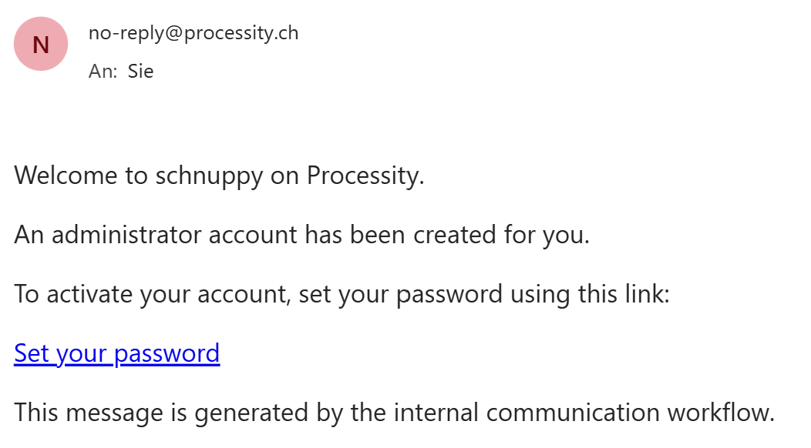
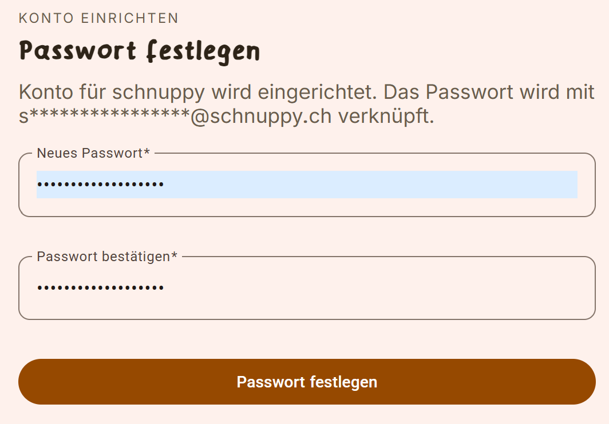
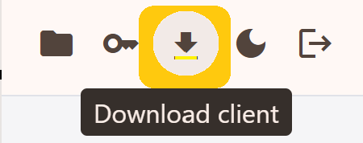
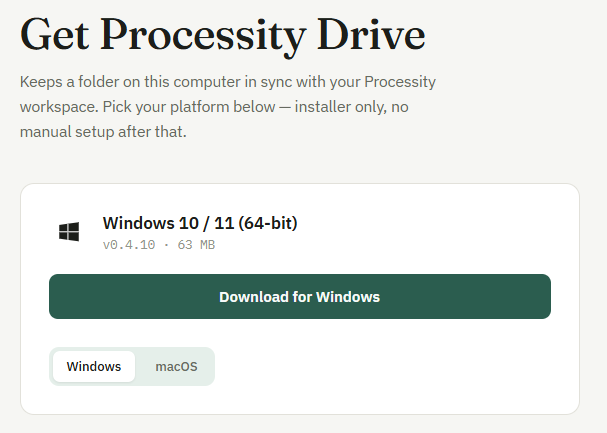
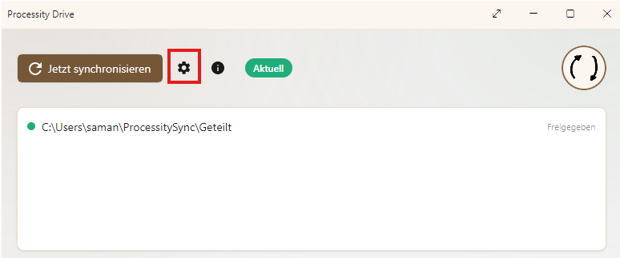
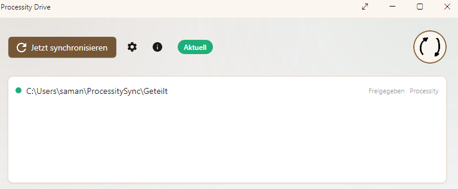

# Processity Drive — Getting Started & Sync Client Setup

Welcome to Processity Drive! This guide walks you through activating
your account, using Drive in your browser, and setting up the desktop
Sync Client so a folder on your computer stays automatically in sync.

---

## Getting started

### 1. Receive your invitation

Your administrator adds you as a contact in Processity. You'll receive
an invitation email with a **Set your password** link.

### 2. Set your password

Click **Set your password** in the email. On the screen that opens,
choose a password that meets these requirements:

- At least 10 characters
- Upper and lower case letters, a number, and a symbol
- No sequential number series (e.g. `1234`) and no character repeated 3
  or more times in a row

Click **Set password** to finish setting up your account.

### 3. Sign in to Drive in your browser

Go to **[drive.processity.ch](https://drive.processity.ch/)** and sign
in with your new password. You can browse and use your shared folders
directly here — no extra setup needed.

---

## Setting up the desktop Sync Client

If you'd like a local folder on your computer that stays automatically
in sync with Drive, install the desktop Sync Client — it works the same
way as the OneDrive or Google Drive desktop apps.

### 4. Download the client

Click the **Download client** icon in Drive's toolbar.

The download page automatically detects whether you're on Windows or
macOS and offers the matching installer.

### 5. Install and add your account

Open the installed app and go to **Settings** (gear icon). On the
**Accounts** tab, click **+** to add a new account, then sign in with
the same details you used to set up your Processity account.

### 6. Start syncing

Back in the Processity Drive app, click **Sync now**. Your account is
now connected — a local sync folder is created on your computer, and
your shared files start syncing into it automatically.

---

## Related

- [Processity Drive — overview](./architecture.md) — what Drive is, its
  components, security, and licensing
