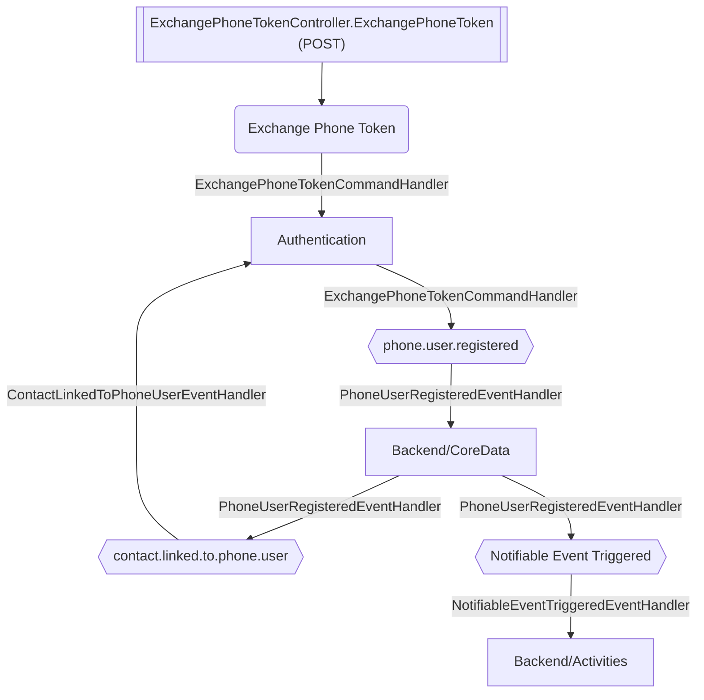

# Exchange Phone Token

**Auto-generated from code — do not hand-edit.** Regenerate with
`tools/generate-docs.mjs` in the docs repo whenever the source repos change.

- **Controller**: ExchangePhoneTokenController.ExchangePhoneToken
- **Endpoints**:
  - `POST /authentication/v{version:apiVersion}/account/exchange-phone-token` (via ApiGateway; internally `api/v{version:apiVersion}/account/exchange-phone-token`)
- **Module**: Authentication
- **Modules touched by this flow**: Authentication, Backend/CoreData, Backend/Activities

## Continues Into

This flow's own trace ends before these, but they pick up from a node it touches:

- [Admin User Registered](#/flows/Authentication/admin-user-registered)
- [Bootstrap](#/flows/Authentication/bootstrap)
- [Create First Admin](#/flows/Authentication/create-first-admin)
- [Login](#/flows/Authentication/login)
- [Login Desktop](#/flows/Authentication/login-desktop)
- [Register](#/flows/Authentication/register)
- [Register Tenant](#/flows/Authentication/register-tenant)
- [Send Set Password Link](#/flows/Authentication/send-set-password-link)
- [Tenant Schema Update Required](#/flows/Authentication/tenant-schema-update-required)
- [Contact Linked To Admin User](#/flows/Backend/CoreData/contact-linked-to-admin-user)
- [Add User](#/flows/ImmoBroker/add-user)
- [Onboard Member](#/flows/ImmoBroker/onboard-member)
- [Remove User](#/flows/ImmoBroker/remove-user)
- [Update User Role](#/flows/ImmoBroker/update-user-role)
- [Reprovision Tenant](#/flows/TenantProvisioning/reprovision-tenant)
- [Tenant Provisioning Completed](#/flows/TenantProvisioning/tenant-provisioning-completed)
- [Create Notification](#/flows/Backend/Activities/create-notification)
- [Assign](#/flows/Backend/Communications/assign)
- [Cancel Meeting](#/flows/Backend/Communications/cancel-meeting)
- [Create Meeting](#/flows/Backend/Communications/create-meeting)
- [Respond By Token](#/flows/Backend/Communications/respond-by-token)
- [Respond To Appointment Invitation](#/flows/Backend/Communications/respond-to-appointment-invitation)
- [Respond To Invitation](#/flows/Backend/Communications/respond-to-invitation)
- [Send Appointment Invitation](#/flows/Backend/Communications/send-appointment-invitation)
- [Send Invitations](#/flows/Backend/Communications/send-invitations)
- [Submit](#/flows/Backend/Communications/submit)
- [Note Creation Triggered](#/flows/Backend/SocialCare/note-creation-triggered)
- [Set Availability](#/flows/Backend/StaffManagement/set-availability)
- [Set Worktime Schedule](#/flows/Backend/StaffManagement/set-worktime-schedule)
- [Delete Notification](#/flows/ImmoBroker/delete-notification)
- [Get Notifications](#/flows/ImmoBroker/get-notifications)
- [Service Registered](#/flows/SharedKernel/service-registered)
- [Migration Status Check Requested](#/flows/TenantProvisioning/migration-status-check-requested)
- [Produces Response Type](#/flows/TenantProvisioning/produces-response-type)
- [Service Tenant Licenses Sync](#/flows/TenantProvisioning/service-tenant-licenses-sync)
- [Trigger Schema Update](#/flows/TenantProvisioning/trigger-schema-update)
