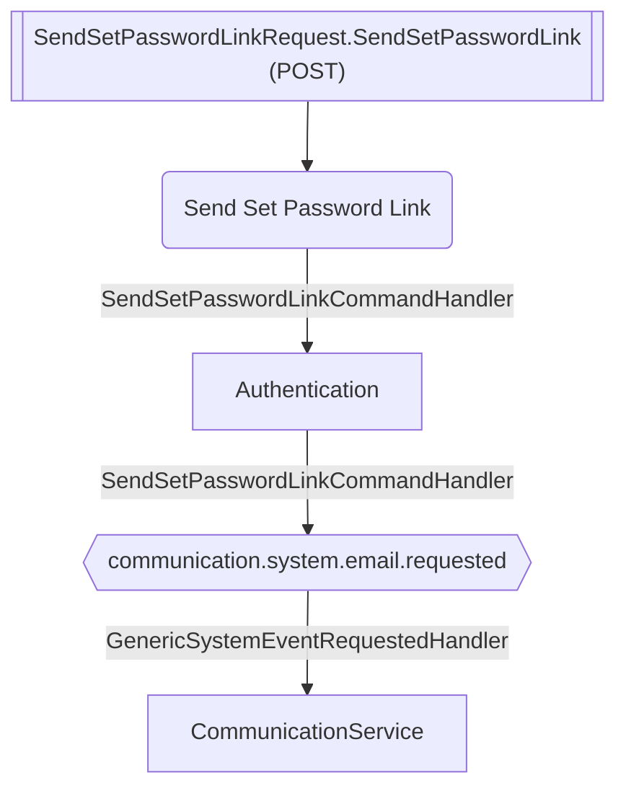

# Send Set Password Link

**Auto-generated from code — do not hand-edit.** Regenerate with
`tools/generate-docs.mjs` in the docs repo whenever the source repos change.

- **Controller**: SendSetPasswordLinkRequest.SendSetPasswordLink
- **Endpoints**:
  - `POST ` (no ApiGateway route resolved)
- **Module**: Authentication
- **Modules touched by this flow**: Authentication, CommunicationService

## Continues Into

This flow's own trace ends before these, but they pick up from a node it touches:

- [Bootstrap](#/flows/Authentication/bootstrap)
- [Create First Admin](#/flows/Authentication/create-first-admin)
- [Login](#/flows/Authentication/login)
- [Login Desktop](#/flows/Authentication/login-desktop)
