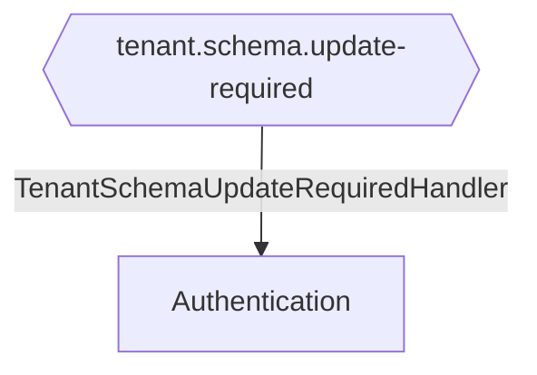

# Tenant Schema Update Required

**Auto-generated from code — do not hand-edit.** Regenerate with
`tools/generate-docs.mjs` in the docs repo whenever the source repos change.

- **Trigger**: automatically published event `tenant.schema.update-required` (no HTTP endpoint - fired by a background process or another handler)
- **Module**: Authentication
- **Modules touched by this flow**: Authentication

## Continues Into

This flow's own trace ends before these, but they pick up from a node it touches:

- [Admin User Registered](#/flows/Authentication/admin-user-registered)
- [Bootstrap](#/flows/Authentication/bootstrap)
- [Create First Admin](#/flows/Authentication/create-first-admin)
- [Exchange Phone Token](#/flows/Authentication/exchange-phone-token)
- [Login](#/flows/Authentication/login)
- [Login Desktop](#/flows/Authentication/login-desktop)
- [Register](#/flows/Authentication/register)
- [Register Tenant](#/flows/Authentication/register-tenant)
- [Send Set Password Link](#/flows/Authentication/send-set-password-link)
- [Contact Linked To Admin User](#/flows/Backend/CoreData/contact-linked-to-admin-user)
- [Add User](#/flows/ImmoBroker/add-user)
- [Onboard Member](#/flows/ImmoBroker/onboard-member)
- [Remove User](#/flows/ImmoBroker/remove-user)
- [Update User Role](#/flows/ImmoBroker/update-user-role)
- [Reprovision Tenant](#/flows/TenantProvisioning/reprovision-tenant)
- [Tenant Provisioning Completed](#/flows/TenantProvisioning/tenant-provisioning-completed)
