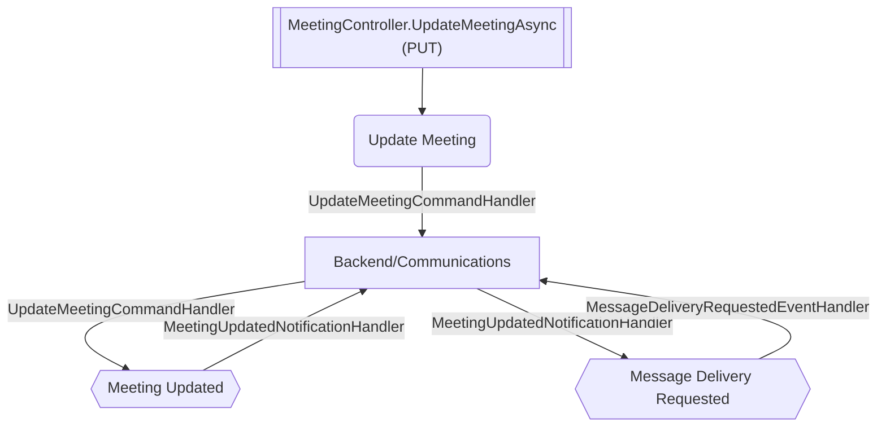

# Update Meeting

**Auto-generated from code — do not hand-edit.** Regenerate with
`tools/generate-docs.mjs` in the docs repo whenever the source repos change.

- **Controller**: MeetingController.UpdateMeetingAsync
- **Endpoints**:
  - `PUT /communications/v{version:apiVersion}/interactions/meetings/{id}` (via ApiGateway; internally `api/communications/v{version:apiVersion}/interactions/meetings/{id}`)
- **Module**: Backend/Communications
- **Modules touched by this flow**: Backend/Communications

## Continues Into

This flow's own trace ends before these, but they pick up from a node it touches:

- [Accept Proposed Time](#/flows/Backend/Communications/accept-proposed-time)
- [Appointment Created](#/flows/Backend/Communications/appointment-created)
- [Assign](#/flows/Backend/Communications/assign)
- [Cancel Meeting](#/flows/Backend/Communications/cancel-meeting)
- [Create Call Activity](#/flows/Backend/Communications/create-call-activity)
- [Create Meeting](#/flows/Backend/Communications/create-meeting)
- [Respond By Token](#/flows/Backend/Communications/respond-by-token)
- [Respond To Appointment Invitation](#/flows/Backend/Communications/respond-to-appointment-invitation)
- [Respond To Invitation](#/flows/Backend/Communications/respond-to-invitation)
- [Save External As Contact](#/flows/Backend/Communications/save-external-as-contact)
- [Send Appointment Invitation](#/flows/Backend/Communications/send-appointment-invitation)
- [Send Invitations](#/flows/Backend/Communications/send-invitations)
- [Submit](#/flows/Backend/Communications/submit)
- [Create Referrer Employee](#/flows/Backend/SocialCare/create-referrer-employee)
- [Create Booking](#/flows/Calendar/create-booking)
- [Chat Conversation Ended](#/flows/RealtimeInteraction/chat-conversation-ended)
- [Chat Message Sent](#/flows/RealtimeInteraction/chat-message-sent)
- [Service Registered](#/flows/SharedKernel/service-registered)
- [Migration Status Check Requested](#/flows/TenantProvisioning/migration-status-check-requested)
- [Produces Response Type](#/flows/TenantProvisioning/produces-response-type)
- [Reprovision Tenant](#/flows/TenantProvisioning/reprovision-tenant)
- [Service Tenant Licenses Sync](#/flows/TenantProvisioning/service-tenant-licenses-sync)
- [Trigger Schema Update](#/flows/TenantProvisioning/trigger-schema-update)
