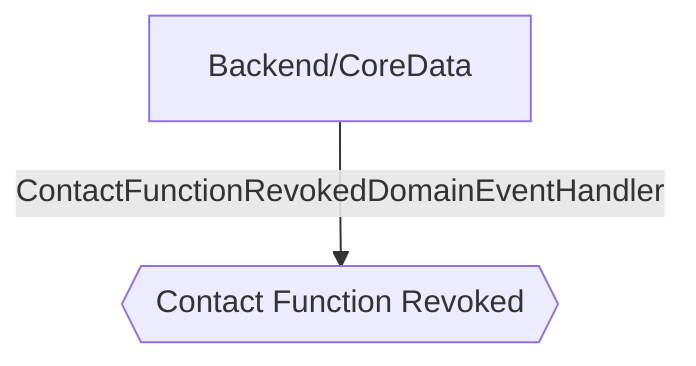

# Contact Function Revoked

**Auto-generated from code — do not hand-edit.** Regenerate with
`tools/generate-docs.mjs` in the docs repo whenever the source repos change.

- **Trigger**: automatically published event `contact.function.revoked` (no HTTP endpoint - fired by a background process or another handler)
- **Module**: Backend/CoreData
- **Modules touched by this flow**: Backend/CoreData

