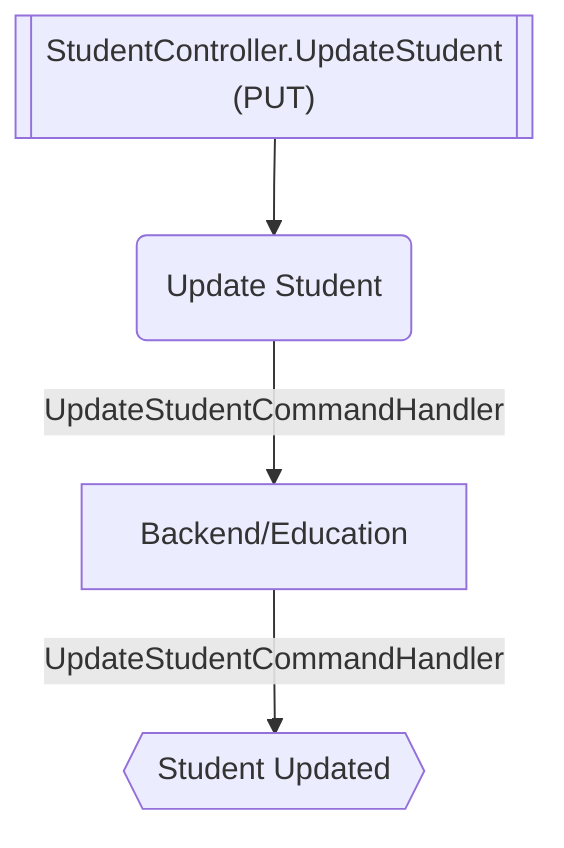

# Update Student

**Auto-generated from code — do not hand-edit.** Regenerate with
`tools/generate-docs.mjs` in the docs repo whenever the source repos change.

- **Controller**: StudentController.UpdateStudent
- **Endpoints**:
  - `PUT /education/v{version:apiVersion}/students/{id:guid}` (via ApiGateway; internally `api/education/v{version:apiVersion}/students/{id:guid}`)
- **Module**: Backend/Education
- **Modules touched by this flow**: Backend/Education

