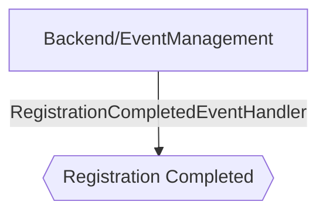

# Event Registration Completed

**Auto-generated from code — do not hand-edit.** Regenerate with
`tools/generate-docs.mjs` in the docs repo whenever the source repos change.

- **Trigger**: automatically published event `event.registration.completed` (no HTTP endpoint - fired by a background process or another handler)
- **Module**: Backend/EventManagement
- **Modules touched by this flow**: Backend/EventManagement

## Continues Into

This flow's own trace ends before these, but they pick up from a node it touches:

- [Event Management Registration Completed](#/flows/Backend/EventManagement/event-management-registration-completed)
