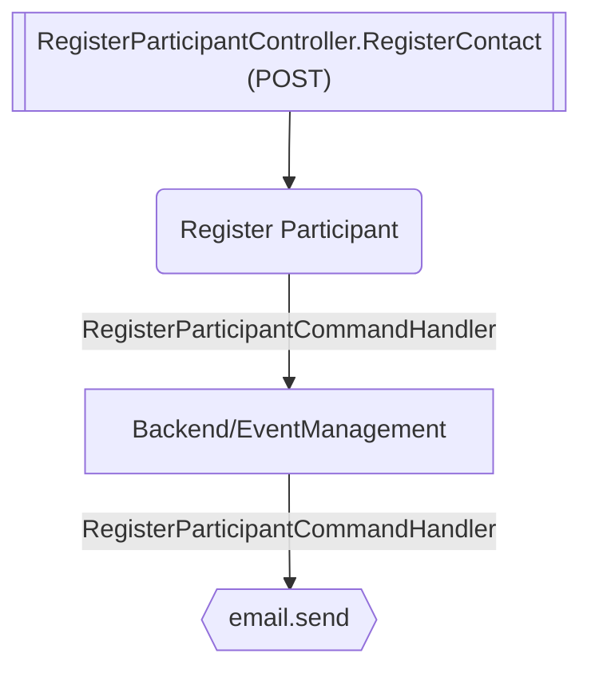

# Register Contact

**Auto-generated from code — do not hand-edit.** Regenerate with
`tools/generate-docs.mjs` in the docs repo whenever the source repos change.

- **Controller**: RegisterParticipantController.RegisterContact
- **Endpoints**:
  - `POST /event-management/v{version:apiVersion}/registrations` (via ApiGateway; internally `api/event-management/v{version:apiVersion}/registrations`)
- **Module**: Backend/EventManagement
- **Modules touched by this flow**: Backend/EventManagement

## Continues Into

This flow's own trace ends before these, but they pick up from a node it touches:

- [Initiate Registration Cancellation](#/flows/Backend/EventManagement/initiate-registration-cancellation)
- [Register Contact Preliminary](#/flows/Backend/EventManagement/register-contact-preliminary)
