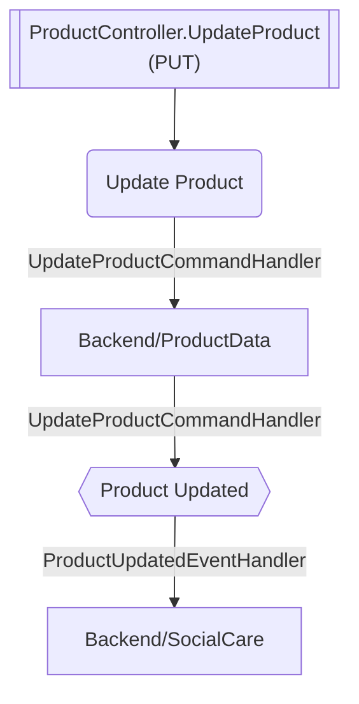

# Update Product

**Auto-generated from code — do not hand-edit.** Regenerate with
`tools/generate-docs.mjs` in the docs repo whenever the source repos change.

- **Controller**: ProductController.UpdateProduct
- **Endpoints**:
  - `PUT /sales/v{version:apiVersion}/products/{id:guid}` (via ApiGateway; internally `api/sales/v{version:apiVersion}/products/{id:guid}`)
- **Module**: Backend/ProductData
- **Modules touched by this flow**: Backend/ProductData, Backend/SocialCare

## Continues Into

This flow's own trace ends before these, but they pick up from a node it touches:

- [Module Assignment Requested](#/flows/AutomationService/module-assignment-requested)
- [Contact Data Updated](#/flows/Backend/CoreData/contact-data-updated)
- [Create Product](#/flows/Backend/ProductData/create-product)
- [Delete Product](#/flows/Backend/ProductData/delete-product)
- [Create Referrer Employee](#/flows/Backend/SocialCare/create-referrer-employee)
- [Note Creation Triggered](#/flows/Backend/SocialCare/note-creation-triggered)
- [Service Registered](#/flows/SharedKernel/service-registered)
- [Migration Status Check Requested](#/flows/TenantProvisioning/migration-status-check-requested)
- [Produces Response Type](#/flows/TenantProvisioning/produces-response-type)
- [Reprovision Tenant](#/flows/TenantProvisioning/reprovision-tenant)
- [Service Tenant Licenses Sync](#/flows/TenantProvisioning/service-tenant-licenses-sync)
- [Trigger Schema Update](#/flows/TenantProvisioning/trigger-schema-update)
