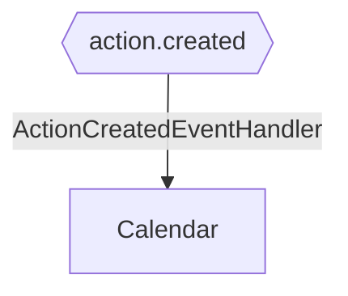

# Action Created

**Auto-generated from code — do not hand-edit.** Regenerate with
`tools/generate-docs.mjs` in the docs repo whenever the source repos change.

- **Trigger**: automatically published event `action.created` (no HTTP endpoint - fired by a background process or another handler)
- **Module**: Calendar
- **Modules touched by this flow**: Calendar

## Continues Into

This flow's own trace ends before these, but they pick up from a node it touches:

- [Appointment Created](#/flows/Backend/Communications/appointment-created)
- [Add Absence](#/flows/Backend/StaffManagement/add-absence)
- [Create Override](#/flows/Backend/StaffManagement/create-override)
- [Complete Calendar Item](#/flows/Calendar/complete-calendar-item)
- [Create Booking](#/flows/Calendar/create-booking)
- [Create Calendar Item](#/flows/Calendar/create-calendar-item)
- [Put Item](#/flows/Calendar/put-item)
- [Update Calendar Item](#/flows/Calendar/update-calendar-item)
- [Service Registered](#/flows/SharedKernel/service-registered)
- [Migration Status Check Requested](#/flows/TenantProvisioning/migration-status-check-requested)
- [Produces Response Type](#/flows/TenantProvisioning/produces-response-type)
- [Reprovision Tenant](#/flows/TenantProvisioning/reprovision-tenant)
- [Service Tenant Licenses Sync](#/flows/TenantProvisioning/service-tenant-licenses-sync)
- [Trigger Schema Update](#/flows/TenantProvisioning/trigger-schema-update)
