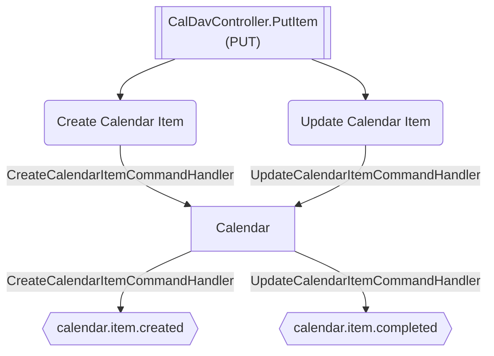

# Put Item

**Auto-generated from code — do not hand-edit.** Regenerate with
`tools/generate-docs.mjs` in the docs repo whenever the source repos change.

- **Controller**: CalDavController.PutItem
- **Endpoints**:
  - `PUT /calendar/caldav/{ownerId:guid}/{uid}.ics` (via ApiGateway; internally `api/calendar/caldav/{ownerId:guid}/{uid}.ics`)
- **Module**: Calendar
- **Modules touched by this flow**: Calendar

## Continues Into

This flow's own trace ends before these, but they pick up from a node it touches:

- [Create Calendar Item](#/flows/Calendar/create-calendar-item)
- [Complete Calendar Item](#/flows/Calendar/complete-calendar-item)
- [Update Calendar Item](#/flows/Calendar/update-calendar-item)
