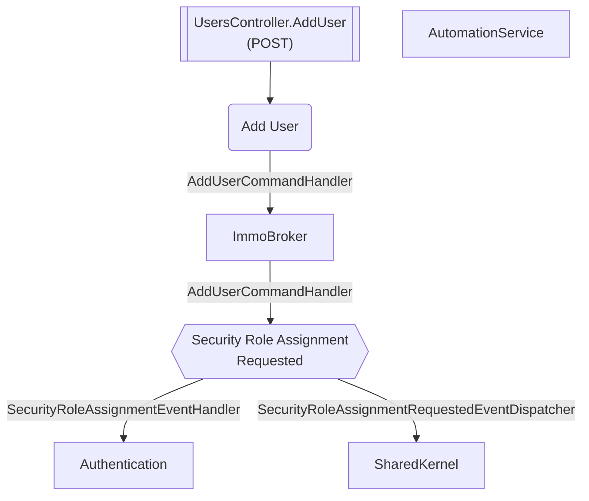

# Add User

**Auto-generated from code — do not hand-edit.** Regenerate with
`tools/generate-docs.mjs` in the docs repo whenever the source repos change.

- **Controller**: UsersController.AddUser
- **Endpoints**:
  - `POST /planning/v{version:apiVersion}/users` (via ApiGateway; internally `api/planning/v{version:apiVersion}/users`)
  - `POST /planning/v{version:apiVersion}/users` (via ApiGateway; internally `api/planning/v{version:apiVersion}/users`)
- **Module**: ImmoBroker
- **Modules touched by this flow**: ImmoBroker, Authentication, SharedKernel, AutomationService

## Continues Into

This flow's own trace ends before these, but they pick up from a node it touches:

- [Admin User Registered](#/flows/Authentication/admin-user-registered)
- [Bootstrap](#/flows/Authentication/bootstrap)
- [Create First Admin](#/flows/Authentication/create-first-admin)
- [Exchange Phone Token](#/flows/Authentication/exchange-phone-token)
- [Login](#/flows/Authentication/login)
- [Login Desktop](#/flows/Authentication/login-desktop)
- [Register](#/flows/Authentication/register)
- [Register Tenant](#/flows/Authentication/register-tenant)
- [Send Set Password Link](#/flows/Authentication/send-set-password-link)
- [Tenant Schema Update Required](#/flows/Authentication/tenant-schema-update-required)
- [Contact Linked To Admin User](#/flows/Backend/CoreData/contact-linked-to-admin-user)
- [Onboard Member](#/flows/ImmoBroker/onboard-member)
- [Remove User](#/flows/ImmoBroker/remove-user)
- [Update User Role](#/flows/ImmoBroker/update-user-role)
- [Reprovision Tenant](#/flows/TenantProvisioning/reprovision-tenant)
- [Tenant Provisioning Completed](#/flows/TenantProvisioning/tenant-provisioning-completed)
- [Note Creation Triggered](#/flows/Backend/SocialCare/note-creation-triggered)
- [Action Next Requested](#/flows/SharedKernel/action-next-requested)
- [Module Migration Status Reported](#/flows/SharedKernel/module-migration-status-reported)
- [Module Provisioning Completed](#/flows/SharedKernel/module-provisioning-completed)
- [Module Provisioning Failed](#/flows/SharedKernel/module-provisioning-failed)
- [Service Registered](#/flows/SharedKernel/service-registered)
- [Migration Status Check Requested](#/flows/TenantProvisioning/migration-status-check-requested)
- [Produces Response Type](#/flows/TenantProvisioning/produces-response-type)
- [Service Tenant Licenses Sync](#/flows/TenantProvisioning/service-tenant-licenses-sync)
- [Trigger Schema Update](#/flows/TenantProvisioning/trigger-schema-update)
