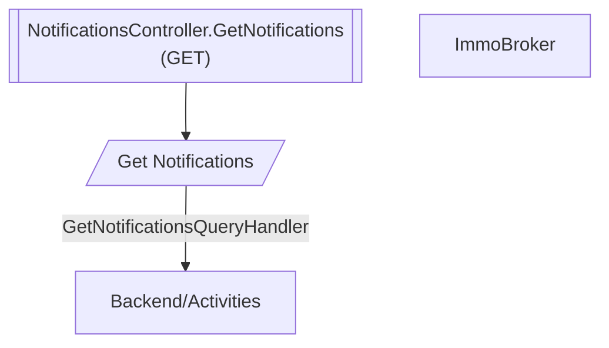

# Get Notifications

**Auto-generated from code — do not hand-edit.** Regenerate with
`tools/generate-docs.mjs` in the docs repo whenever the source repos change.

- **Controller**: NotificationsController.GetNotifications
- **Endpoints**:
  - `GET /planning/v{version:apiVersion}/notifications` (via ApiGateway; internally `api/planning/v{version:apiVersion}/notifications`)
  - `GET /planning/v{version:apiVersion}/notifications` (via ApiGateway; internally `api/planning/v{version:apiVersion}/notifications`)
- **Module**: ImmoBroker
- **Modules touched by this flow**: ImmoBroker, Backend/Activities

## Continues Into

This flow's own trace ends before these, but they pick up from a node it touches:

- [Exchange Phone Token](#/flows/Authentication/exchange-phone-token)
- [Create Notification](#/flows/Backend/Activities/create-notification)
- [Assign](#/flows/Backend/Communications/assign)
- [Cancel Meeting](#/flows/Backend/Communications/cancel-meeting)
- [Create Meeting](#/flows/Backend/Communications/create-meeting)
- [Respond By Token](#/flows/Backend/Communications/respond-by-token)
- [Respond To Appointment Invitation](#/flows/Backend/Communications/respond-to-appointment-invitation)
- [Respond To Invitation](#/flows/Backend/Communications/respond-to-invitation)
- [Send Appointment Invitation](#/flows/Backend/Communications/send-appointment-invitation)
- [Send Invitations](#/flows/Backend/Communications/send-invitations)
- [Submit](#/flows/Backend/Communications/submit)
- [Note Creation Triggered](#/flows/Backend/SocialCare/note-creation-triggered)
- [Set Availability](#/flows/Backend/StaffManagement/set-availability)
- [Set Worktime Schedule](#/flows/Backend/StaffManagement/set-worktime-schedule)
- [Delete Notification](#/flows/ImmoBroker/delete-notification)
- [Service Registered](#/flows/SharedKernel/service-registered)
- [Migration Status Check Requested](#/flows/TenantProvisioning/migration-status-check-requested)
- [Produces Response Type](#/flows/TenantProvisioning/produces-response-type)
- [Reprovision Tenant](#/flows/TenantProvisioning/reprovision-tenant)
- [Service Tenant Licenses Sync](#/flows/TenantProvisioning/service-tenant-licenses-sync)
- [Trigger Schema Update](#/flows/TenantProvisioning/trigger-schema-update)
