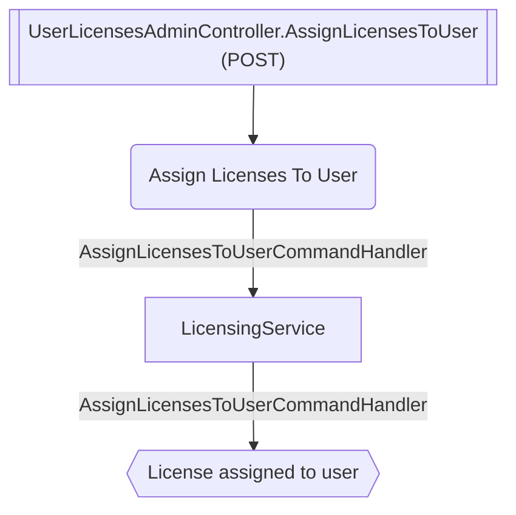

# Assign Licenses To User

**Auto-generated from code — do not hand-edit.** Regenerate with
`tools/generate-docs.mjs` in the docs repo whenever the source repos change.

- **Controller**: UserLicensesAdminController.AssignLicensesToUser
- **Endpoints**:
  - `POST /licensing-admin/v{version:apiVersion}/users/bulk` (via ApiGateway; internally `api/licensing-admin/v{version:apiVersion}/users/bulk`)
- **Module**: LicensingService
- **Modules touched by this flow**: LicensingService

## Continues Into

This flow's own trace ends before these, but they pick up from a node it touches:

- [Assign License To User](#/flows/LicensingService/assign-license-to-user)
