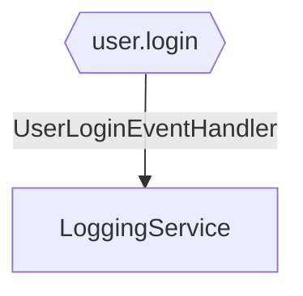

# User Login

**Auto-generated from code — do not hand-edit.** Regenerate with
`tools/generate-docs.mjs` in the docs repo whenever the source repos change.

- **Trigger**: automatically published event `user.login` (no HTTP endpoint - fired by a background process or another handler)
- **Module**: LoggingService
- **Modules touched by this flow**: LoggingService

## Continues Into

This flow's own trace ends before these, but they pick up from a node it touches:

- [Event Logged](#/flows/LoggingService/event-logged)
- [Service Registered](#/flows/SharedKernel/service-registered)
- [Produces Response Type](#/flows/TenantProvisioning/produces-response-type)
- [Reprovision Tenant](#/flows/TenantProvisioning/reprovision-tenant)
- [Service Tenant Licenses Sync](#/flows/TenantProvisioning/service-tenant-licenses-sync)
- [Trigger Schema Update](#/flows/TenantProvisioning/trigger-schema-update)
