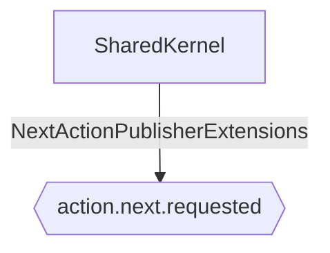

# Action Next Requested

**Auto-generated from code — do not hand-edit.** Regenerate with
`tools/generate-docs.mjs` in the docs repo whenever the source repos change.

- **Trigger**: automatically published event `action.next.requested` (no HTTP endpoint - fired by a background process or another handler)
- **Module**: SharedKernel
- **Modules touched by this flow**: SharedKernel

