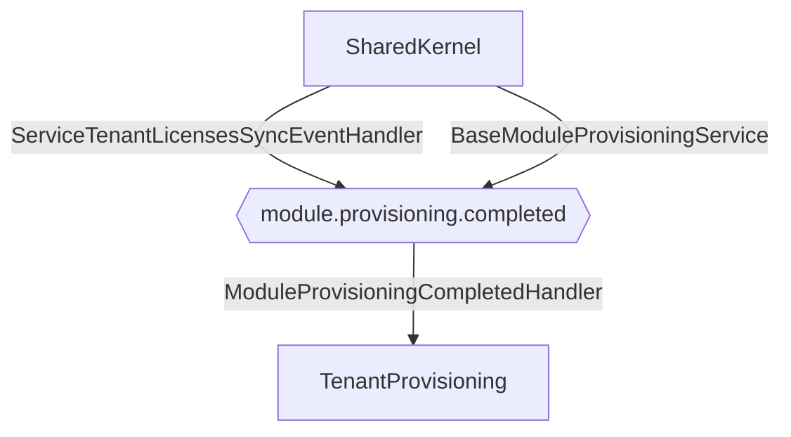

# Module Provisioning Completed

**Auto-generated from code — do not hand-edit.** Regenerate with
`tools/generate-docs.mjs` in the docs repo whenever the source repos change.

- **Trigger**: automatically published event `module.provisioning.completed` (no HTTP endpoint - fired by a background process or another handler)
- **Module**: SharedKernel
- **Modules touched by this flow**: SharedKernel, TenantProvisioning

## Continues Into

This flow's own trace ends before these, but they pick up from a node it touches:

- [Register Tenant](#/flows/Authentication/register-tenant)
- [Handle Stripe Webhook](#/flows/BillingService/handle-stripe-webhook)
- [Assign License To Tenant](#/flows/LicensingService/assign-license-to-tenant)
- [Module Migration Status Reported](#/flows/SharedKernel/module-migration-status-reported)
- [Module Provisioning Failed](#/flows/SharedKernel/module-provisioning-failed)
- [Service Registered](#/flows/SharedKernel/service-registered)
- [Migration Status Check Requested](#/flows/TenantProvisioning/migration-status-check-requested)
- [Produces Response Type](#/flows/TenantProvisioning/produces-response-type)
- [Reprovision Tenant](#/flows/TenantProvisioning/reprovision-tenant)
- [Service Tenant Licenses Sync](#/flows/TenantProvisioning/service-tenant-licenses-sync)
- [Tenant Provisioning Completed](#/flows/TenantProvisioning/tenant-provisioning-completed)
- [Trigger Schema Update](#/flows/TenantProvisioning/trigger-schema-update)
