# Service Tenant Licenses Sync

**Auto-generated from code — do not hand-edit.** Regenerate with
`tools/generate-docs.mjs` in the docs repo whenever the source repos change.

- **Trigger**: automatically published event `service.tenant-licenses.sync` (no HTTP endpoint - fired by a background process or another handler)
- **Module**: TenantProvisioning
- **Modules touched by this flow**: TenantProvisioning, AutomationService, Backend/Activities, Backend/CareManagement, Backend/Communications, Backend/CoreData, Backend/Education, Backend/EventManagement, Backend/ProductData, Backend/RelationshipModule, Backend/Sales, Backend/SocialCare, Backend/StaffManagement, BillingService, Calendar, FileService, ImmoBroker, IntegrationService, LoggingService, MappingService, Planning, RealtimeInteraction, SettingsService, SharedKernel

```mermaid
flowchart TB
  EVT_service_tenant_licenses_sync{{"service.tenant-licenses.sync"}}
  MOD_TenantProvisioning["TenantProvisioning"]
  MOD_TenantProvisioning -->|ServiceRegistrationHandler| EVT_service_tenant_licenses_sync
  MOD_AutomationService["AutomationService"]
  EVT_service_tenant_licenses_sync -->|AutomationTenantLicensesSyncHandler| MOD_AutomationService
  MOD_Backend_Activities["Backend/Activities"]
  EVT_service_tenant_licenses_sync -->|ActivitiesTenantLicensesSyncHandler| MOD_Backend_Activities
  MOD_Backend_CareManagement["Backend/CareManagement"]
  EVT_service_tenant_licenses_sync -->|CareManagementTenantLicensesSyncHandler| MOD_Backend_CareManagement
  MOD_Backend_Communications["Backend/Communications"]
  EVT_service_tenant_licenses_sync -->|CommunicationsTenantLicensesSyncHandler| MOD_Backend_Communications
  MOD_Backend_CoreData["Backend/CoreData"]
  EVT_service_tenant_licenses_sync -->|CoreDataTenantLicensesSyncHandler| MOD_Backend_CoreData
  MOD_Backend_Education["Backend/Education"]
  EVT_service_tenant_licenses_sync -->|EducationTenantLicensesSyncHandler| MOD_Backend_Education
  MOD_Backend_EventManagement["Backend/EventManagement"]
  EVT_service_tenant_licenses_sync -->|EventManagementTenantLicensesSyncHandler| MOD_Backend_EventManagement
  MOD_Backend_ProductData["Backend/ProductData"]
  EVT_service_tenant_licenses_sync -->|ProductDataTenantLicensesSyncHandler| MOD_Backend_ProductData
  MOD_Backend_RelationshipModule["Backend/RelationshipModule"]
  EVT_service_tenant_licenses_sync -->|RelationshipModuleTenantLicensesSyncHandler| MOD_Backend_RelationshipModule
  MOD_Backend_Sales["Backend/Sales"]
  EVT_service_tenant_licenses_sync -->|SalesTenantLicensesSyncHandler| MOD_Backend_Sales
  MOD_Backend_SocialCare["Backend/SocialCare"]
  EVT_service_tenant_licenses_sync -->|SocialCareTenantLicensesSyncHandler| MOD_Backend_SocialCare
  MOD_Backend_StaffManagement["Backend/StaffManagement"]
  EVT_service_tenant_licenses_sync -->|StaffManagementTenantLicensesSyncHandler| MOD_Backend_StaffManagement
  MOD_BillingService["BillingService"]
  EVT_service_tenant_licenses_sync -->|BillingTenantLicensesSyncHandler| MOD_BillingService
  MOD_Calendar["Calendar"]
  EVT_service_tenant_licenses_sync -->|CalendarTenantLicensesSyncHandler| MOD_Calendar
  MOD_FileService["FileService"]
  EVT_service_tenant_licenses_sync -->|FileServiceTenantLicensesSyncHandler| MOD_FileService
  MOD_ImmoBroker["ImmoBroker"]
  EVT_service_tenant_licenses_sync -->|ImmoBrokerTenantLicensesSyncHandler| MOD_ImmoBroker
  MOD_IntegrationService["IntegrationService"]
  EVT_service_tenant_licenses_sync -->|IntegrationTenantLicensesSyncHandler| MOD_IntegrationService
  MOD_LoggingService["LoggingService"]
  EVT_service_tenant_licenses_sync -->|LoggingTenantLicensesSyncHandler| MOD_LoggingService
  MOD_MappingService["MappingService"]
  EVT_service_tenant_licenses_sync -->|MappingTenantLicensesSyncHandler| MOD_MappingService
  MOD_Planning["Planning"]
  EVT_service_tenant_licenses_sync -->|PlanningTenantLicensesSyncHandler| MOD_Planning
  MOD_RealtimeInteraction["RealtimeInteraction"]
  EVT_service_tenant_licenses_sync -->|RealtimeInteractionTenantLicensesSyncHandler| MOD_RealtimeInteraction
  MOD_SettingsService["SettingsService"]
  EVT_service_tenant_licenses_sync -->|SettingsTenantLicensesSyncHandler| MOD_SettingsService
  MOD_SharedKernel["SharedKernel"]
  EVT_service_tenant_licenses_sync -->|ServiceTenantLicensesSyncEventHandler| MOD_SharedKernel
  EVT_module_provisioning_completed{{"module.provisioning.completed"}}
  MOD_AutomationService -->|AutomationTenantLicensesSyncHandler| EVT_module_provisioning_completed
  EVT_module_provisioning_completed -->|ModuleProvisioningCompletedHandler| MOD_TenantProvisioning
  EVT_module_schema_update_completed{{"module.schema.update-completed"}}
  MOD_AutomationService -->|AutomationTenantLicensesSyncHandler| EVT_module_schema_update_completed
  EVT_module_schema_update_completed -->|ModuleSchemaUpdateCompletedHandler| MOD_TenantProvisioning
```

## Continues Into

This flow's own trace ends before these, but they pick up from a node it touches:

- [Exchange Phone Token](#/flows/Authentication/exchange-phone-token)
- [Create Notification](#/flows/Backend/Activities/create-notification)
- [Assign](#/flows/Backend/Communications/assign)
- [Cancel Meeting](#/flows/Backend/Communications/cancel-meeting)
- [Create Meeting](#/flows/Backend/Communications/create-meeting)
- [Respond By Token](#/flows/Backend/Communications/respond-by-token)
- [Respond To Appointment Invitation](#/flows/Backend/Communications/respond-to-appointment-invitation)
- [Respond To Invitation](#/flows/Backend/Communications/respond-to-invitation)
- [Send Appointment Invitation](#/flows/Backend/Communications/send-appointment-invitation)
- [Send Invitations](#/flows/Backend/Communications/send-invitations)
- [Submit](#/flows/Backend/Communications/submit)
- [Note Creation Triggered](#/flows/Backend/SocialCare/note-creation-triggered)
- [Set Availability](#/flows/Backend/StaffManagement/set-availability)
- [Set Worktime Schedule](#/flows/Backend/StaffManagement/set-worktime-schedule)
- [Delete Notification](#/flows/ImmoBroker/delete-notification)
- [Get Notifications](#/flows/ImmoBroker/get-notifications)
- [Service Registered](#/flows/SharedKernel/service-registered)
- [Migration Status Check Requested](#/flows/TenantProvisioning/migration-status-check-requested)
- [Produces Response Type](#/flows/TenantProvisioning/produces-response-type)
- [Reprovision Tenant](#/flows/TenantProvisioning/reprovision-tenant)
- [Trigger Schema Update](#/flows/TenantProvisioning/trigger-schema-update)
- [Register Relative Relationship](#/flows/Backend/CareManagement/register-relative-relationship)
- [Accept Proposed Time](#/flows/Backend/Communications/accept-proposed-time)
- [Appointment Created](#/flows/Backend/Communications/appointment-created)
- [Create Call Activity](#/flows/Backend/Communications/create-call-activity)
- [Save External As Contact](#/flows/Backend/Communications/save-external-as-contact)
- [Update Meeting](#/flows/Backend/Communications/update-meeting)
- [Create Referrer Employee](#/flows/Backend/SocialCare/create-referrer-employee)
- [Create Booking](#/flows/Calendar/create-booking)
- [Chat Conversation Ended](#/flows/RealtimeInteraction/chat-conversation-ended)
- [Chat Message Sent](#/flows/RealtimeInteraction/chat-message-sent)
- [Admin User Registered](#/flows/Authentication/admin-user-registered)
- [Contact Data Updated](#/flows/Backend/CoreData/contact-data-updated)
- [Contact Function Assigned](#/flows/Backend/CoreData/contact-function-assigned)
- [Contact Function Revoked](#/flows/Backend/CoreData/contact-function-revoked)
- [Contact Linked To Admin User](#/flows/Backend/CoreData/contact-linked-to-admin-user)
- [Get Participants](#/flows/Backend/EventManagement/get-participants)
- [Create Sales Idea](#/flows/Backend/Sales/create-sales-idea)
- [Get Sales Idea Candidates](#/flows/Backend/Sales/get-sales-idea-candidates)
- [Onboard Employee](#/flows/Backend/StaffManagement/onboard-employee)
- [Search](#/flows/ImmoBroker/search)
- [Tenant Provisioning Completed](#/flows/TenantProvisioning/tenant-provisioning-completed)
- [Complete Lesson](#/flows/Backend/Education/complete-lesson)
- [Create Student](#/flows/Backend/Education/create-student)
- [Delete Learning Path Definition](#/flows/Backend/Education/delete-learning-path-definition)
- [Delete Student](#/flows/Backend/Education/delete-student)
- [Enroll](#/flows/Backend/Education/enroll)
- [Update Learning Path Definition](#/flows/Backend/Education/update-learning-path-definition)
- [Update Student](#/flows/Backend/Education/update-student)
- [Event Management Registration Completed](#/flows/Backend/EventManagement/event-management-registration-completed)
- [Event Registration Completed](#/flows/Backend/EventManagement/event-registration-completed)
- [Initiate Registration Cancellation](#/flows/Backend/EventManagement/initiate-registration-cancellation)
- [Register Contact](#/flows/Backend/EventManagement/register-contact)
- [Register Contact Preliminary](#/flows/Backend/EventManagement/register-contact-preliminary)
- [Upload Event Template Certificate](#/flows/Backend/EventManagement/upload-event-template-certificate)
- [Create Product](#/flows/Backend/ProductData/create-product)
- [Delete Product](#/flows/Backend/ProductData/delete-product)
- [Update Product](#/flows/Backend/ProductData/update-product)
- [Module Assignment Requested](#/flows/AutomationService/module-assignment-requested)
- [Add Absence](#/flows/Backend/StaffManagement/add-absence)
- [Create Override](#/flows/Backend/StaffManagement/create-override)
- [Handle Stripe Webhook](#/flows/BillingService/handle-stripe-webhook)
- [Action Created](#/flows/Calendar/action-created)
- [Complete Calendar Item](#/flows/Calendar/complete-calendar-item)
- [Create Calendar Item](#/flows/Calendar/create-calendar-item)
- [Put Item](#/flows/Calendar/put-item)
- [Update Calendar Item](#/flows/Calendar/update-calendar-item)
- [Add User](#/flows/ImmoBroker/add-user)
- [Onboard Member](#/flows/ImmoBroker/onboard-member)
- [Remove User](#/flows/ImmoBroker/remove-user)
- [Update User Role](#/flows/ImmoBroker/update-user-role)
- [Event Logged](#/flows/LoggingService/event-logged)
- [User Login](#/flows/LoggingService/user-login)
- [Action Next Requested](#/flows/SharedKernel/action-next-requested)
- [Module Migration Status Reported](#/flows/SharedKernel/module-migration-status-reported)
- [Module Provisioning Completed](#/flows/SharedKernel/module-provisioning-completed)
- [Module Provisioning Failed](#/flows/SharedKernel/module-provisioning-failed)
- [Register Tenant](#/flows/Authentication/register-tenant)
- [Assign License To Tenant](#/flows/LicensingService/assign-license-to-tenant)
