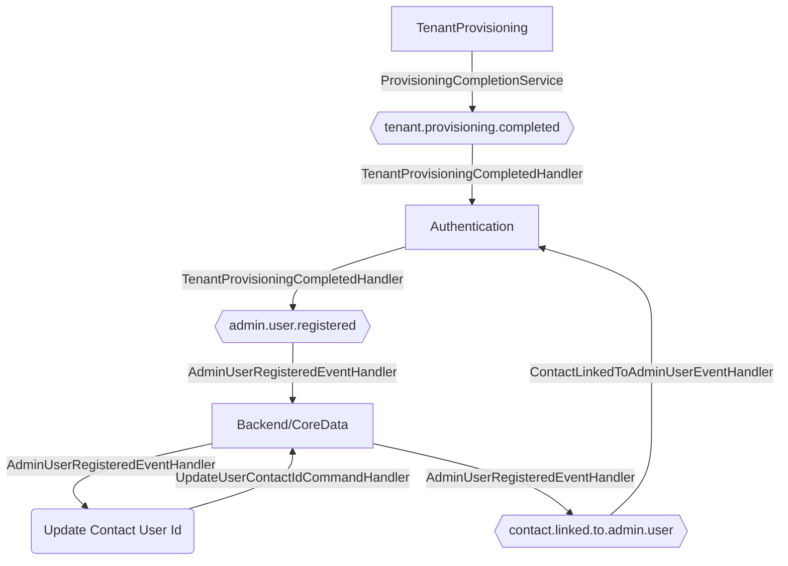

# Tenant Provisioning Completed

**Auto-generated from code — do not hand-edit.** Regenerate with
`tools/generate-docs.mjs` in the docs repo whenever the source repos change.

- **Trigger**: automatically published event `tenant.provisioning.completed` (no HTTP endpoint - fired by a background process or another handler)
- **Module**: TenantProvisioning
- **Modules touched by this flow**: TenantProvisioning, Authentication, Backend/CoreData

## Continues Into

This flow's own trace ends before these, but they pick up from a node it touches:

- [Admin User Registered](#/flows/Authentication/admin-user-registered)
- [Exchange Phone Token](#/flows/Authentication/exchange-phone-token)
- [Register Relative Relationship](#/flows/Backend/CareManagement/register-relative-relationship)
- [Create Call Activity](#/flows/Backend/Communications/create-call-activity)
- [Create Meeting](#/flows/Backend/Communications/create-meeting)
- [Save External As Contact](#/flows/Backend/Communications/save-external-as-contact)
- [Send Appointment Invitation](#/flows/Backend/Communications/send-appointment-invitation)
- [Send Invitations](#/flows/Backend/Communications/send-invitations)
- [Contact Data Updated](#/flows/Backend/CoreData/contact-data-updated)
- [Contact Function Assigned](#/flows/Backend/CoreData/contact-function-assigned)
- [Contact Function Revoked](#/flows/Backend/CoreData/contact-function-revoked)
- [Contact Linked To Admin User](#/flows/Backend/CoreData/contact-linked-to-admin-user)
- [Get Participants](#/flows/Backend/EventManagement/get-participants)
- [Create Sales Idea](#/flows/Backend/Sales/create-sales-idea)
- [Get Sales Idea Candidates](#/flows/Backend/Sales/get-sales-idea-candidates)
- [Create Referrer Employee](#/flows/Backend/SocialCare/create-referrer-employee)
- [Onboard Employee](#/flows/Backend/StaffManagement/onboard-employee)
- [Set Availability](#/flows/Backend/StaffManagement/set-availability)
- [Set Worktime Schedule](#/flows/Backend/StaffManagement/set-worktime-schedule)
- [Create Booking](#/flows/Calendar/create-booking)
- [Search](#/flows/ImmoBroker/search)
- [Service Registered](#/flows/SharedKernel/service-registered)
- [Migration Status Check Requested](#/flows/TenantProvisioning/migration-status-check-requested)
- [Produces Response Type](#/flows/TenantProvisioning/produces-response-type)
- [Reprovision Tenant](#/flows/TenantProvisioning/reprovision-tenant)
- [Service Tenant Licenses Sync](#/flows/TenantProvisioning/service-tenant-licenses-sync)
- [Trigger Schema Update](#/flows/TenantProvisioning/trigger-schema-update)
- [Bootstrap](#/flows/Authentication/bootstrap)
- [Create First Admin](#/flows/Authentication/create-first-admin)
- [Login](#/flows/Authentication/login)
- [Login Desktop](#/flows/Authentication/login-desktop)
- [Register](#/flows/Authentication/register)
- [Register Tenant](#/flows/Authentication/register-tenant)
- [Send Set Password Link](#/flows/Authentication/send-set-password-link)
- [Tenant Schema Update Required](#/flows/Authentication/tenant-schema-update-required)
- [Add User](#/flows/ImmoBroker/add-user)
- [Onboard Member](#/flows/ImmoBroker/onboard-member)
- [Remove User](#/flows/ImmoBroker/remove-user)
- [Update User Role](#/flows/ImmoBroker/update-user-role)
