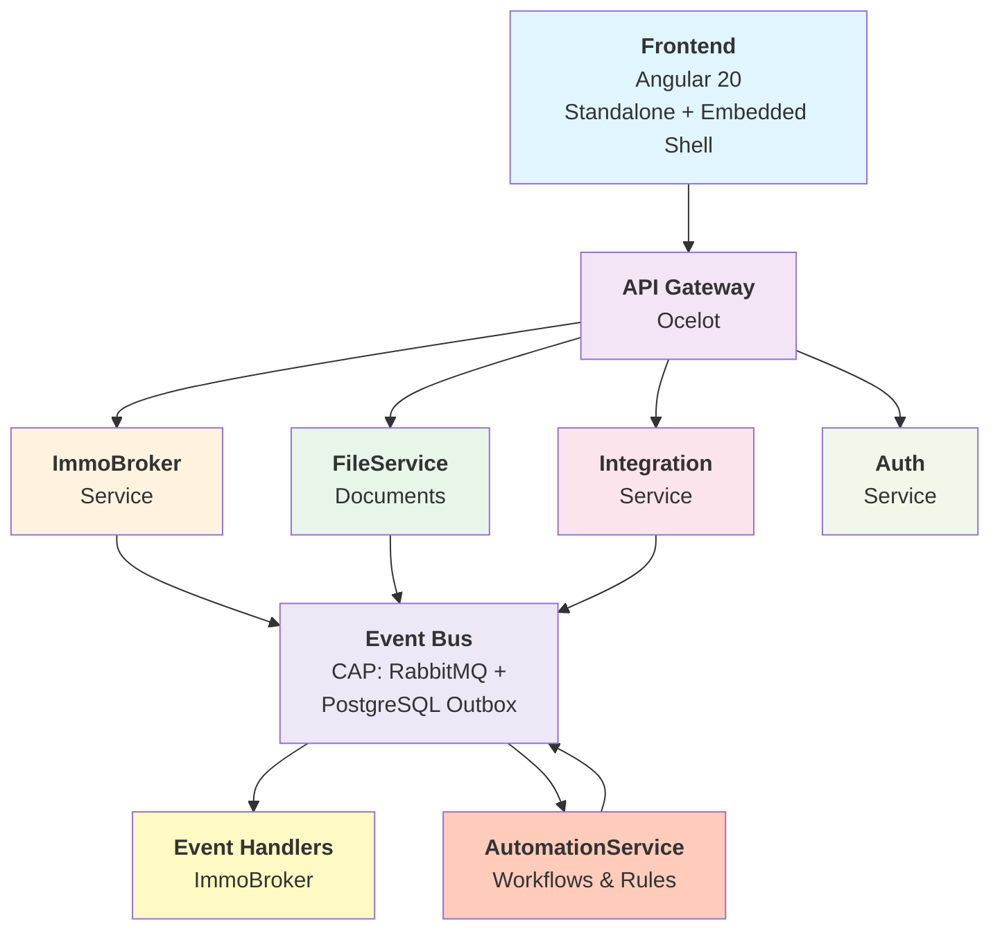

# ImmoBroker — Architecture Guide

## System overview

ImmoBroker is a **multi-tenant SaaS platform** for Swiss real-estate brokers. It's built on the Processity platform using shared infrastructure for authentication, multi-tenancy, event distribution, file management, and more.

### Architecture diagram



---

## Bounded contexts

ImmoBroker is organized into **six semi-independent bounded contexts** (DDD terminology), each with its own domain model, database tables, and API surface:

### 1. Objects (`Objects/`)

**Purpose:** Real-estate listings (apartments, houses, commercial properties).

**Domain model:**

- `RealEstateObject` (aggregate root)
  - `RealEstateObjectId` (typed ID)
  - `Address` (value object: street, number, postal code, city, canton)
  - Properties: status, type, asking price, living area, plot area, rooms, year built
  - Relations: seller contact ID (reference to Contacts), created/updated audit fields

**Key operations:**

- Create, update, archive, list (with filtering by status/type/text)
- Generate URL-safe slug (for public forms in F2)
- Calculate auto-pricing insights (future: ML model)

**External dependencies:**

- None for F1 MVP (foundational)
- F6: FileService (documents)
- F11: Integration service (registry data)
- F15: Integration service (portal sync)

**Database:** `immobroker` schema, table `realestateobjects`

---

### 2. Leads (`Leads/`)

**Purpose:** Inquiries from potential buyers about Objects.

**Domain model:**

- `Lead` (aggregate root)
  - `LeadId` (typed ID)
  - Links to `RealEstateObject` (immutable)
  - Contact info: name, email, phone
  - Status: New, Contacted, Qualified, Rejected, Converted
  - Auto-score: Red/Yellow/Green (F10)
  - Qualification: budget range, equity, timeframe (F3)

**Key operations:**

- Create lead (public form, F2, or portal import, F15)
- Qualify lead (broker manual or AI, F3/F10)
- Reject with template email (F3)
- Link to viewing (F4)

**Event publications:**

- `LeadCreated` (triggers broker notification)
- `LeadQualified` (triggers lead scoring, F10)
- `LeadRescored` (notifies broker)
- `LeadRejected` (triggers template email)
- `LeadConverted` (object sold → de-list portals)

**Database:** `immobroker` schema, table `leads`

---

### 3. Viewings (`Viewings/`)

**Purpose:** Scheduled property tours, linking Leads, Objects, and Calendar service.

**Domain model:**

- `Viewing` (aggregate root)
  - `ViewingId` (typed ID)
  - Links to `RealEstateObject`, `Lead`, Calendar event ID (external)
  - Status: Booked, Confirmed, Completed, NoShow, Cancelled
  - Scheduled time, notes, assigned broker

**Key operations:**

- Book viewing (Lead self-serves from public slot picker, F4)
- Schedule reminders (AutomationService, F5)
- Record feedback (public form, F5)
- Complete/cancel (broker action)

**Event publications:**

- `ViewingBooked` (triggers reminder scheduling, F5)
- `ViewingCompleted` (triggers feedback request, F5)
- `ViewingCancelled`

**Integrations:**

- **Calendar service:** Create, read, delete events
- **CommunicationService:** SMS/email reminders, feedback links (F5)
- **AutomationService:** Workflow orchestration (F5)

**Database:** `immobroker` schema, tables `viewings`, `viewingslots`

---

### 4. Documents (`Documents/`)

**Purpose:** Per-object checklists of required documents (contracts, certifications, deeds) and file uploads.

**Domain model:**

- `DocumentChecklist` (aggregate root per Object)
  - `DocumentChecklistId` (typed ID)
  - List of `DocumentChecklistItem` (value objects)
    - Type (e.g., "Grundbuchauszug", "GEAK", "Kaufvertrag")
    - Required flag
    - Status: Missing, Uploaded, SentToLead, Signed
    - File ID (reference to FileService)
    - Metadata: document date, expires, version

**Key operations:**

- Get checklist for object type
- Upload document file (FileService integration)
- Mark item complete/shared
- Fetch auto-registry documents (F11)
- Generate contract draft (F13)

**Event subscriptions:**

- Subscribe to `RegistryDocumentFetched` (F11) → auto-update checklist
- Subscribe to `ContractDrafted` (F13) → add to checklist
- Subscribe to `DocumentSigned` (F14) → mark as signed

**Database:** `immobroker` schema, table `documentchecklists`, `documentchecklistitems`

---

### 5. Inbox (`Inbox/`)

**Purpose:** Unified thread view per Object×Contact, joining ImmoBroker events + Communications service history + broker notes.

**Domain model:**

- `InboxThread` (aggregate root)
  - `InboxThreadId` (typed ID)
  - Links to `RealEstateObject`, Contact (external ID)
  - `CorrelationId` (key for joining with Communications.Interactions)
  - Broker notes (text field, editable)
  - Message history (computed from Communications + local events)
  - Unread flag

**Key operations:**

- Get thread for Object×Contact pair
- Add internal note (broker-only)
- Mark as read/unread
- Search across threads

**Event subscriptions:**

- Subscribe to `CommunicationSent` (from Communications module)
- Subscribe to `LeadCreated`, `ViewingBooked` (local events)
- Subscribe to `FeedbackSubmitted` (from Viewings)

**Real-time:**

- SignalR group: `object:<object-id>` → broadcast new messages/notes
- Live notification on new lead/viewing in thread

**Database:** `immobroker` schema, table `inboxthreads`, `inboxthrreadnotes`

---

### 6. Contacts (`Contacts/`)

**Purpose:** Seller and lead contact records.

**Domain model:**

- `ImmoBrokerContact` (aggregate root)
  - `ImmoBrokerContactId` (typed ID)
  - Name, email, phone
  - Type: Seller, Buyer, Agent
  - Optional: link to CoreData Contact (external ID)

**Key operations:**

- Create, update contact
- Manage contact preferences (communication channels, opt-out)
- Link Object to seller contact

**Database:** `immobroker` schema, table `contacts`

---

## Data flow

### Create Object → Public Intake Form → Qualification → Viewing → Feedback

```
1. Broker creates Object (F1)
   → Generate slug
   → Publish "ObjectCreated" event
   → SPA shows Object list + detail

2. Anonymous user submits public inquiry form (F2)
   → POST /api/immobroker/public/inquire/{slug}
   → Resolve tenant via Object's slug
   → Create Lead
   → Publish "LeadCreated" event
   → Send broker email notification

3. Broker sees new lead in inbox (F7)
   → Reviews contact + message
   → Qualifies: Hot/Warm/Cold/Rejected (F3)
   → If Rejected: send template email (F3)
   → If Hot/Warm: lead appears in booking slots UI (F4)
   → Publish "LeadQualified" event

4. Lead receives magic link to book viewing (F4)
   → Picks available slot
   → Create Viewing
   → Call Calendar service: create event
   → Publish "ViewingBooked" event
   → Send lead confirmation email (F4)

5. AutomationService receives "ViewingBooked" (F5)
   → Schedule reminders: T-48h, T-24h, T-2h
   → Publish "ReminderScheduled" event

6. Reminders fire on schedule (F5)
   → CommunicationService sends SMS/email
   → Lead arrives to viewing

7. Post-viewing (T+2h after scheduled time) (F5)
   → CommunicationService sends feedback link
   → Lead submits feedback
   → Publish "FeedbackSubmitted" event

8. Broker sees aggregate feedback (F5)
   → Object detail → Feedback tab
   → Shows: positive%, themes, trends
```

### AI Scoring Flow

```
Lead qualifies (manually or via F3)
→ Publish "LeadQualified" event
→ AutomationService rule engine evaluates:
   - Purchase intent
   - Timeframe
   - Budget vs. asking price
   - Equity ratio
   - [Optional F12] Hypothekar pre-check result
→ Score: Green / Yellow / Red
→ Update Lead.AutoScore
→ Publish "LeadRescored" event
→ Broadcast to SignalR: object:<object-id>
→ Broker inbox sorts by score
```

---

## Technology stack

### Backend (.NET 10)

| Layer               | Technology                               | Notes                                        |
| ------------------- | ---------------------------------------- | -------------------------------------------- |
| **Framework**       | ASP.NET Core 10                          | REST API, OpenAPI/Swagger                    |
| **Database**        | PostgreSQL 16                            | Multi-tenant schema per Finbuckle            |
| **ORM**             | Entity Framework Core 10                 | Code-first migrations                        |
| **Validation**      | Data Annotations                         | No FluentValidation in Processity            |
| **DI**              | Microsoft.Extensions.DependencyInjection | Native, no third-party containers            |
| **Async messaging** | CAP (with RabbitMQ + PostgreSQL Outbox)  | Reliably publishes/subscribes domain events  |
| **Caching**         | Redis (via SharedKernel)                 | Session tokens, tenant metadata              |
| **Logging**         | Serilog                                  | Structured logs to centralized sink          |
| **Authorization**   | Policy-based (custom auth middleware)    | Roles + permissions from Auth service        |
| **HTTP client**     | HttpClient + generated clients           | NSwag-generated C# clients for service calls |

### Frontend (Angular 20)

| Layer                 | Technology                            | Notes                                      |
| --------------------- | ------------------------------------- | ------------------------------------------ |
| **Framework**         | Angular 20                            | Standalone components, routing, DI         |
| **Build**             | Vite (via nx)                         | Fast dev server + optimized production     |
| **Styling**           | SCSS                                  | BEM-like component scoping                 |
| **HTTP**              | HttpClient + NSwag-generated clients  | Type-safe API calls                        |
| **State**             | Component-level observables + signals | No NgRx; keep local                        |
| **Module Federation** | Native Angular module federation      | Embed in main host app                     |
| **i18n**              | ngx-translate (API-driven)            | Kebab-case keys, translations from backend |
| **UI components**     | Angular Material                      | Material Design, accessibility built-in    |
| **Real-time**         | SignalR client                        | Live inbox updates, notifications          |
| **Auth**              | OIDC (via Auth service)               | Login flow managed by main host            |

### Infrastructure

| Service                             | Purpose                                           | Integration                                       |
| ----------------------------------- | ------------------------------------------------- | ------------------------------------------------- |
| **Processity.Authentication**       | OIDC provider, JWT tokens, role registry          | ImmoBroker calls `/authorize`, validates JWT      |
| **Processity.Authorization**        | Permission & role management                      | Bootstrap roles on tenant provision               |
| **Processity.EventBus** (CAP)       | Async event distribution                          | Publish domain events, subscribe to others        |
| **Processity.FileService**          | File storage, versioning, metadata                | Store documents, retrieve file URLs               |
| **Processity.Integration**          | Third-party adapters (banks, registries, portals) | Call external APIs, wrap responses                |
| **Processity.Calendar**             | Event scheduling, availability                    | Book viewings, reserve time slots                 |
| **Processity.CommunicationService** | Email, SMS, templates                             | Send notifications, rejection emails, reminders   |
| **Processity.AutomationService**    | Workflow engine, rule evaluation                  | Schedule reminders, score leads, generate reports |
| **Processity.TenantProvisioning**   | Multi-tenant onboarding                           | New broker tenant → provision DB, roles, defaults |
| **ApiGateway (Ocelot)**             | Route aggregation, auth                           | Route `/api/immobroker/*` → ImmoBroker service    |

---

## Code organization

### Backend structure

```
src/
  ImmoBroker.Core/
    Common/
      DI/                          ← DependencyInjection extensions
      Data/
        ImmoBrokerDbContext.cs     ← Primary DbContext (multi-tenant)
        IImmoBrokerDbContext.cs    ← Interface (for mocking in tests)
        Configurations/            ← EF FluentAPI per entity
      Domain/
        ValueObjects/
          ImmoBrokerIds.cs         ← All TypedId definitions
      Behaviors/                   ← Cross-cutting: validation, logging
      Licensing/                   ← Feature discovery provider
      Provisioning/                ← Tenant setup handlers
    Objects/
      Domain/
        RealEstateObject.cs        ← Aggregate root
        Address.cs                 ← Value object
      Application/
        RealEstateObjectDto.cs     ← DTO
        CreateObject/
          CreateObjectCommand.cs
          CreateObjectCommandHandler.cs
          CreateObjectRequest.cs
        ListObjects/
          ListObjectsQuery.cs
          ListObjectsQueryHandler.cs
        UpdateObject/
          UpdateObjectCommand.cs
          UpdateObjectCommandHandler.cs
      Controllers/
        ObjectsController.cs        ← REST endpoints
      Infrastructure/
        RealEstateObjectRepository.cs ← Generic repo, typed
    Leads/
      Domain/
        Lead.cs
        LeadStatus.cs
      Application/
        LeadDto.cs
        CreateLead/
        QualifyLead/
        RejectLead/
      Controllers/
        LeadsController.cs
      Infrastructure/
        LeadRepository.cs
    Viewings/
    Documents/
    Inbox/
    Contacts/
    Auth/
      Authorization/
        ImmoBrokerPermissions.cs    ← All permission constants
        ImmoBrokerRoles.cs          ← Role definitions
        ImmoBrokerRoleRegistration.cs
        ImmoBrokerAuthorizationBootstrap.cs
    Notifications/                 ← Event handlers (local pub/sub)
  ImmoBroker.Host/
    Program.cs                     ← Setup DI, middleware
    appsettings.Local.json         ← Dev config
    Extensions/
      SwaggerExtensions.cs         ← OpenAPI doc groups
  ImmoBroker.Migrations/
    Migrations/                    ← EF Core migrations
    ImmoBrokerMigrationsDbContext.cs
```

### Frontend structure

```
src/immobroker/
  app/
    app.config.ts                  ← Global app config
    app.routes.ts                  ← Lazy-loaded feature routes
    auth/                          ← Auth shell (login, OIDC callback)
    dashboard/                     ← Broker dashboard
    objects/
      objects.routes.ts            ← Nested routes: list, detail, form
      object-list/
        object-list.component.ts   ← Table, pagination, filters
        object-list.component.html
      object-detail/
        object-detail.component.ts ← Tabs: overview, docs, inbox, feedback
      object-form/
        object-form.component.ts   ← Create/edit form
      object-create-dialog/
        object-create-dialog.component.ts ← Modal trigger
    leads/
      leads.routes.ts
      lead-list/                   ← Lead inbox per object
      lead-detail/                 ← Qualification panel
    viewings/
      viewing-list/                ← Scheduled viewings
      viewing-form/                ← Slot booking / reschedule
    documents/
      object-documents-list/       ← Checklist + file upload
    inbox/
      inbox-list/                  ← Thread list per object
      inbox-detail/                ← Thread view + notes
    settings/
      user-management/             ← Broker user roles
    shells/
      standalone-shell/            ← Full-page app (immobroker.processity.localdev)
      embedded-shell/              ← Iframe embed (in main host app)
  shared/
    services/
      api/
        immobroker-*.client.ts     ← NSwag-generated API clients
      immobroker-navigation.service.ts ← Route helpers
      immobroker-auth.service.ts   ← Auth state (login, logout, roles)
    models/
      immobroker.models.ts         ← Shared types (objects-data.types.ts, etc.)
    constants/
      immobroker-roles.ts          ← Role constants matching backend
```

---

## Authorization model

ImmoBroker uses **role-based access control (RBAC)** via the Processity Authorization service:

### Roles

| Role              | Permissions                                                                     | Use case                          |
| ----------------- | ------------------------------------------------------------------------------- | --------------------------------- |
| **Broker**        | Objects.Manage, Leads.Manage, Viewings.Manage, Documents.Manage, Inbox.Read     | Primary user—full feature access  |
| **OfficeManager** | All (Broker) + Users.Manage, Settings.Manage                                    | Administrative office tasks       |
| **PeopleManager** | Leads.Read, Viewings.Read, Inbox.Read                                           | View leads/viewings (no edit)     |
| **SalesAgent**    | Objects.Read, Leads.Manage, Viewings.Manage                                     | Limited to their assigned objects |
| **Seller**        | Objects.Read (own), Viewings.Read (own), Inbox.Read (own), Documents.Read (own) | External seller portal (future)   |

### Permissions

- `immobroker.objects.create`
- `immobroker.objects.read`
- `immobroker.objects.update`
- `immobroker.objects.delete` (archive only)
- `immobroker.leads.create`
- `immobroker.leads.read`
- `immobroker.leads.qualify`
- `immobroker.leads.reject`
- ... (similar for other domains)

**Multi-tenancy enforcement:** Middleware extracts tenant ID from JWT or custom header → all queries filtered by `TenantId` via `ICurrentTenantProvider`. Violations log security alerts.

---

## Event-driven architecture

ImmoBroker publishes and subscribes to **domain events** via CAP (event bus):

### Published events

Each aggregate publishes events after state changes:

```csharp
// Example: Lead.cs
public class Lead : BaseEntity<LeadId>
{
    public void Qualify(LeadQualificationRequest request)
    {
        this.QualificationScore = request.Score;
        this.AddDomainEvent(new LeadQualifiedEvent(this.Id, request.Score));
    }
}

// Published via IEventPublisher in handler
public class QualifyLeadCommandHandler(IRepository<Lead> repo, IEventPublisher eventPublisher)
{
    public async Task Handle(QualifyLeadCommand cmd)
    {
        var lead = await repo.GetByIdAsync(cmd.LeadId);
        lead.Qualify(cmd.Request);
        await repo.UpdateAsync(lead);

        foreach (var evt in lead.DomainEvents)
            await eventPublisher.PublishAsync(evt); // Via CAP
    }
}
```

### Event subscriptions

Other services subscribe to events:

```csharp
// In AutomationService
[Topic("immobroker.events.viewingbooked")]
public async Task OnViewingBooked(ViewingBookedEvent evt)
{
    // Schedule reminders in workflow
    await _workflowEngine.CreateReminderWorkflow(evt.ViewingId, evt.ScheduledTime);
}
```

### Core event types

| Event               | Aggregate | Subscribers                             | Payload                     |
| ------------------- | --------- | --------------------------------------- | --------------------------- |
| `ObjectCreated`     | Object    | Licensing, Portal adapters              | Id, slug, tenant            |
| `ObjectUpdated`     | Object    | Portal adapters                         | Id, updated fields          |
| `ObjectArchived`    | Object    | Portal adapters (de-list)               | Id                          |
| `LeadCreated`       | Lead      | Notifications (email to broker)         | Id, object id, contact      |
| `LeadQualified`     | Lead      | AI scoring (F10), AutomationService     | Id, score                   |
| `LeadRejected`      | Lead      | CommunicationService (template email)   | Id, reason                  |
| `ViewingBooked`     | Viewing   | AutomationService (reminder scheduling) | Id, lead id, scheduled time |
| `ViewingCompleted`  | Viewing   | CommunicationService (feedback request) | Id, feedback link           |
| `DocumentUploaded`  | Checklist | Communications (notify parties)         | Id, file id, doc type       |
| `FeedbackSubmitted` | Feedback  | Inbox (thread update), Notifications    | Id, viewing id, rating      |

---

## Integration patterns

### Service-to-service calls

**Synchronous (request-reply):**

```csharp
// ImmoBroker calling Calendar service
public class BookViewingCommandHandler(ICalendarClient calendarClient, IRepository<Viewing> repo)
{
    public async Task Handle(BookViewingCommand cmd)
    {
        // Create Calendar event
        var calendarEvent = await calendarClient.CreateEventAsync(new CreateEventRequest
        {
            Title = $"Viewing: {cmd.ObjectAddress}",
            StartTime = cmd.SlotStart,
            EndTime = cmd.SlotEnd,
            Location = cmd.ObjectAddress,
        });

        // Link to Viewing aggregate
        var viewing = new Viewing(cmd.ObjectId, cmd.LeadId, calendarEvent.Id, cmd.SlotStart);
        await repo.AddAsync(viewing);
    }
}
```

**Asynchronous (event-driven):**

```csharp
// F11: AutomationService fetches documents when Object is created
[Topic("immobroker.events.objectcreated")]
public async Task OnObjectCreated(ObjectCreatedEvent evt)
{
    var docChecklist = _getChecklistForType(evt.ObjectType);

    foreach (var item in docChecklist.Items)
    {
        // Call Integration service adapter
        var doc = await _integrationClient.FetchRegistryDocAsync(
            new FetchDocRequest { Canton = evt.Canton, DocType = item.Type }
        );

        // Publish document-fetched event
        await _eventPublisher.PublishAsync(
            new RegistryDocumentFetchedEvent(evt.ObjectId, item.Id, doc.FileId)
        );
    }
}
```

### Error handling

- **Timeouts:** Retries with exponential backoff (Polly)
- **Failures:** Log and continue; eventually-consistent via event republishing
- **Compensation:** AutomationService can define rollback workflows (e.g., undo reminder if viewing cancelled)

---

## Database schema

### Tables (PostgreSQL)

**Tenant & identity:**

- `tenants` (from Finbuckle.MultiTenant)
- `tenantconnectionstrings`

**Objects:**

- `realestateobjects` (address, type, status, slug, created/updated)
- `realestateobject_addresses` (owned entity)

**Leads:**

- `leads` (object id, contact, status, auto score, created/updated)

**Viewings:**

- `viewings` (lead id, object id, scheduled time, calendar event id, status)
- `viewingslots` (object id, availability windows)

**Documents:**

- `documentchecklists` (object id)
- `documentchecklistitems` (type, required, status, file id, expires)

**Inbox:**

- `inboxthreads` (object id, contact id, correlation id)
- `inboxnotes` (thread id, note text, created by)

**Contacts:**

- `contacts` (name, email, phone, type, coredata id link)

**Audit:**

- All entities have `CreatedAt`, `UpdatedAt`, `CreatedBy`, `UpdatedBy` (via BaseEntity)

---

## Security considerations

### Input validation

- All API endpoints validate request DTOs via data annotations
- File uploads validated: size < 50MB, mime-type whitelist
- Geographic data (addresses) validated against Swiss postal database

### Output encoding

- HTML escaping in Angular templates (automatic via Angular sanitizer)
- JSON serialization avoids circular references (settings in DbContext)

### Multi-tenancy

- Tenant ID extracted from JWT `tid` claim or custom header
- All queries filtered by `TenantId` (enforced at DbContext query interceptor)
- Violations logged; failed queries throw `ForbiddenException`

### Secrets

- Database password: retrieved from KeyVault on startup
- API credentials (bank APIs, portal adapters): stored in KeyVault, not in code
- JWT signing key: from Auth service's JWKS endpoint

### CORS

- Frontend origins whitelist: `https://immobroker.processity.ch`, `https://immobroker.processity.dev`
- Public endpoints (inquiry form) CORS permissive (no auth required)
- Authenticated endpoints CORS restricted

---

## Performance considerations

### Caching

- **Database queries:** Entity cache (EF Core first-level) + Redis for cross-request state
- **Computed values:** Lazy-load aggregate details (separate query per domain)
- **Frequent lookups:** Object slug → cache in Redis with 5-min TTL

### Query optimization

- Use `.ToListAsync()` minimally; prefer async IQueryable materialization
- Index on: `(TenantId, Status)`, `(TenantId, CreatedAt)`, `(TenantId, Slug)`
- Avoid N+1: use `.Include()` for eager-loading related aggregates

### Frontend optimization

- Lazy-load feature routes (Angular `loadChildren`)
- Virtual scrolling for large lists (CDK virtual-scroll-viewport)
- Image optimization: serve via FileService with CDN (future)
- Signal-based change detection (Angular 17+)

---

## Testing strategy

### Unit tests

- Test domain entities in isolation
- Mock external dependencies (repositories, event publishers)
- Location: `test/Processity.ImmoBroker.UnitTests/`

### Integration tests

- Boot real DbContext (in-memory SQLite or Testcontainers PostgreSQL)
- Call handlers with real dependencies
- Verify state changes + events published
- Location: `test/Processity.ImmoBroker.IntegrationTests/`

### API tests

- Provision a test tenant
- Make HTTP requests via test client
- Verify response DTOs + database state
- Test multi-tenant isolation
- Location: `test/Processity.ImmoBroker.APITests/`

### Example test

```csharp
[Fact]
public async Task CreateObject_WithValidRequest_CreatesAndReturnsDto()
{
    // Arrange
    var client = await _testHost.CreateAuthenticatedClientAsync("immobroker_id", tenantId);
    var request = new CreateObjectRequest
    {
        Address = new { Street = "Bahnhofstrasse 1", PostalCode = "8001", City = "Zurich" },
        Type = "Wohnung",
        AskingPrice = 750000,
        Rooms = 3,
    };

    // Act
    var response = await client.PostAsJsonAsync("/api/immobroker/v1/objects", request);

    // Assert
    response.StatusCode.Should().Be(HttpStatusCode.Created);
    var dto = await response.Content.ReadAsAsync<RealEstateObjectDto>();
    dto.Slug.Should().NotBeNullOrEmpty();

    var dbObject = await _dbContext.RealEstateObjects.FirstAsync(o => o.Id == dto.Id);
    dbObject.TenantId.Should().Be(tenantId);
}
```

---

## Deployment & environments

### Local development

- **Backend:** `docker compose up` in `.docker/local/`
- **Frontend:** `ng serve Processity.ImmoBroker.App` → localhost:4200 (via main host)
- **Database:** PostgreSQL 16 (container)
- **Event bus:** RabbitMQ (container)

### CI/CD

- **Branch:** `main` → auto-deploy to UAT environment
- **Tag:** `v*` → promote to production
- **Pipeline:** .github/workflows/immobroker-build.yml (uses shared matrix jobs)

---

## Future architecture considerations

1. **CQRS read models** — Separate reporting queries from transactional writes (if F9 reporting becomes complex)
2. **Event sourcing** — Audit trail via immutable event store (consider for financial transactions in F12)
3. **Saga pattern** — Multi-step workflows across services (e.g., F13 contract generation + F14 signing)
4. **GraphQL** — Alternative query language for flexible frontend needs (if list/filter complexity grows)
5. **Cache invalidation** — Pub/sub invalidation protocol if Redis cache hits performance ceiling
