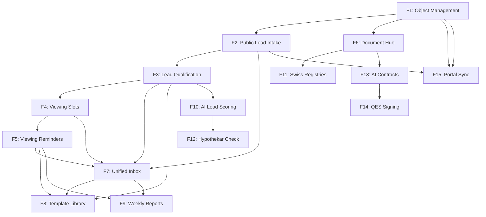

# ImmoBroker — Feature Roadmap & Delivery Plan

## Overview

ImmoBroker is a Swiss real-estate broker process platform designed to streamline the entire property lifecycle: from listing creation through lead management, viewing coordination, document handling, and contract execution. The platform replaces scattered spreadsheets, emails, and manual workflows with an integrated, tenant-aware system.

## Development phases

The product rollout is divided into three phases spanning 7+ months:

| Phase       | Timeline   | Features | Value                    |
| ----------- | ---------- | -------- | ------------------------ |
| **Phase 1** | Months 1–3 | F1–F5    | Lead funnel end-to-end   |
| **Phase 2** | Months 4–6 | F6–F9    | Document/inbox/reporting |
| **Phase 3** | Month 7+   | F10–F15  | AI, integrations, polish |

---

## Feature backlog (delivery order)

### Phase 1: Lead funnel (F1–F5)

#### F1 — Real-Estate Object Management

**Status:** ⏳ In progress  
**Standalone value:** Centralized listing record — replaces Excel/email tracking  
**Dependencies:** None (foundational)

Broker creates a listing record: address, type (Wohnung/Haus/MFH/Gewerbe/Grundstück), asking price, key facts (rooms, m², year), seller contact, status (Draft/Active/Reserved/Sold/Archived). List view with filters, detail view with edit, soft-archive. Each Object gets a URL-safe slug for the public intake form (F2).

**Key entities:**

- `RealEstateObject` aggregate (BaseEntity, audited)
- `Address` value object (Strasse, Hausnummer, PLZ, Ort, Kanton)
- Status enum: Draft, Active, Reserved, Sold, Archived

**Deliverables:**

- Backend CRUD API with authorization (`ObjectsManage` permission)
- Frontend list/detail/form with filters
- EF Core migration
- Swagger documentation
- API tests (happy path + tenant isolation)

---

#### F2 — Public Lead Intake Form

**Status:** 🔄 Planned (depends on F1)  
**Standalone value:** Structured inquiry capture per object — replaces email triage  
**Dependencies:** F1 (Object model), FileService (optional photo upload)

Each Object gets a public URL (`/inquire/{slug}` on standalone domain). Anonymous form captures contact info (name, email, phone) + initial message. Creates a `Lead` aggregate linked to the Object. Broker sees inbox of leads per object. No qualification yet—just structured capture.

**Key entities:**

- `Lead` aggregate (created-at, contact fields, initial message, linked to RealEstateObject)
- Status enum: New, Contacted, Qualified, Rejected, Converted

**API changes:**

- Public endpoint: `POST /api/immobroker/public/inquire/{slug}` — no auth required, resolves tenant via Object's slug
- Authenticated endpoint: `GET /api/immobroker/v1/objects/{id}/leads` — list leads for an object

**Deliverables:**

- Backend Lead aggregate + public API endpoint
- Frontend public form (embeddable, no-frame design)
- Optional: file upload for viewing photos
- Email notification to broker on new lead

---

#### F3 — Manual Lead Qualification

**Status:** 🔄 Planned (depends on F2)  
**Standalone value:** Broker tags leads Hot/Warm/Cold + standard-rejection action  
**Dependencies:** F2 (Lead model), CommunicationService (email)

Broker reviews leads in inbox, opens a qualification panel: Kaufabsicht, Zeitrahmen, Budget range, Eigenkapital range. Marks lead as Hot / Warm / Cold / Rejected. "Reject" sends a templated standard rejection email. Sets the stage for automated scoring (F10).

**Key fields added to Lead:**

- `QualificationScore` enum: Hot, Warm, Cold, Rejected, Unqualified
- `PurchaseIntent` (string/enum)
- `TimeFrame` (string/enum)
- `BudgetMin`, `BudgetMax` (decimal)
- `EquityMin`, `EquityMax` (decimal)
- `QualificationNotes` (text)
- `RejectionReason` (string)
- `QualifiedAt` timestamp

**Deliverables:**

- Backend update command + handler
- Frontend qualification panel (slide-out form)
- Template-based rejection email integration
- Audit trail on qualification changes

---

#### F4 — Viewing Slot Self-Booking

**Status:** 🔄 Planned (depends on F3)  
**Standalone value:** No more phone-tag — qualified leads pick from broker's available slots  
**Dependencies:** F3 (qualified leads), Calendar service

Broker opens an Object, defines available time windows (e.g., "Sa 10-12 and 14-16"). A "qualified" (Hot/Warm) lead receives a magic link to a public slot picker. Slot reservation creates a Calendar item and a `Viewing` aggregate linking Object↔Lead↔CalendarItem. Lead sees booking confirmation immediately; broker sees tentative viewing on the Object detail.

**Key entities:**

- `ViewingSlot` value object (start time, duration, max capacity)
- `Viewing` aggregate (Object, Lead, scheduled time, status: Booked/Confirmed/Completed/NoShow, linked to Calendar event ID)

**API changes:**

- Authenticated: `POST /api/immobroker/v1/objects/{id}/slots` — create availability windows
- Public: `GET /api/immobroker/public/viewings/{slug}/available-slots` — list open slots
- Public: `POST /api/immobroker/public/viewings/{slug}/book` — reserve a slot (creates Viewing)

**Deliverables:**

- Backend Viewing aggregate + slot management API
- Frontend broker: slot definition UI (calendar grid)
- Frontend public: slot picker (no-auth, calendar widget)
- Calendar service integration (create event, get back ID)
- Confirmation email to lead

---

#### F5 — Viewing Reminders & Feedback

**Status:** 🔄 Planned (depends on F4)  
**Standalone value:** 48h/24h/2h reminders + auto post-viewing feedback request → seller-visible  
**Dependencies:** F4 (Viewing model), CommunicationService, AutomationService

AutomationService workflow triggered on `ViewingBooked`: schedule SMS+email reminders at T-48h / T-24h / T-2h. At T+2h send a feedback questionnaire link. Aggregate feedback (positive/neutral/negative/no-show) into a per-Object summary visible to broker and seller contact.

**Key entities:**

- `ViewingFeedback` aggregate (viewing id, rating, text feedback, visibility: private/shared-with-seller)

**Workflows (AutomationService):**

- `ViewingBookedReminder` — send SMS/email reminders on schedule
- `ViewingFeedbackRequest` — send feedback link post-viewing
- `ViewingFeedbackAggregation` — roll up feedback to Object summary

**API changes:**

- `GET /api/immobroker/v1/objects/{id}/feedback-summary` — aggregate feedback (broker only)

**Deliverables:**

- Workflow definitions in AutomationService
- Backend feedback aggregate + endpoints
- Frontend: feedback submission form (public, magic link)
- Frontend: Object detail → Feedback tab (broker view)
- SMS/email templates (shared library)

---

### Phase 2: Documents & Intelligence (F6–F9)

#### F6 — Document Hub MVP

**Status:** 🔄 Planned (depends on F1)  
**Standalone value:** Per-object checklist of required docs, manual upload, status tracking  
**Dependencies:** F1 (Object model), FileService

Predefined checklist per object type (StWE → Grundbuchauszug, GEAK, Stockwerkreglement, ETV-Protokolle 3J, Versicherungspolice; EFH → different list). Broker uploads docs via FileService. Checklist UI shows status per item (Missing / Uploaded / Sent-to-Lead). Version history via FileService's `ChangesController`.

**Key entities:**

- `DocumentChecklist` aggregate (object id, checklist items with type, required-flag, status)
- `DocumentChecklistItem` value object (name, required, status: Missing/Uploaded/Sent)

**API changes:**

- `GET /api/immobroker/v1/objects/{id}/document-checklist` — get checklist
- `POST /api/immobroker/v1/objects/{id}/checklist-items/{itemId}/upload` — link FileService file to checklist
- `PATCH /api/immobroker/v1/objects/{id}/checklist-items/{itemId}/status` — mark as shared-with-lead

**Deliverables:**

- Backend DocumentChecklist aggregate
- Frontend: Object detail → Documents tab
- Checklist UI (drag-drop file upload, status tracking)
- File history view (via FileService)

---

#### F7 — Unified Inbox Projection

**Status:** 🔄 Planned (depends on F2–F5)  
**Standalone value:** All inquiry/viewing/email/SMS comms per Object×Party in one thread  
**Dependencies:** F2–F5 (models), Communications.Interactions, RealtimeInteraction (SignalR)

Per-Object×PartyContact thread that joins ImmoBroker's `InboxThread` correlation record with `Communications.Interactions` history (email, SMS, portal messages) plus broker-internal notes. Live updates via SignalR hub (replaces periodic polling).

**Key entities:**

- `InboxThread` aggregate (object id, party contact id, correlation-id linking to Communications events, internal notes)

**Integration points:**

- Subscribe to `CommunicationSent` events from Communications module
- Subscribe to `ViewingBooked`, `FeedbackSubmitted` events from ImmoBroker
- Publish thread to SignalR hub group: `object:<object-id>`

**Deliverables:**

- Backend InboxThread aggregate + event handlers
- Frontend: Object detail → Inbox tab (unified thread view)
- SignalR client integration (live message append)
- Internal notes UI (broker-only annotations)

---

#### F8 — Template Library

**Status:** 🔄 Planned (depends on F3, F5)  
**Standalone value:** Reusable email/SMS templates with merge fields  
**Dependencies:** F3, F5 (usage points), Communications.Templates

Tenant-scoped library of email and SMS templates with merge fields (`{ObjectAddress}`, `{ContactFirstName}`, `{ViewingSlot}`, etc.). Used by F3 (rejection), F4 (booking confirmation), F5 (reminders), F7 (manual sends). Templates persist in Communications.Templates with an `ImmoBroker` category tag.

**API changes:**

- `GET /api/immobroker/v1/templates` — list templates
- `POST /api/immobroker/v1/templates` — create/update (admin role)
- `POST /api/immobroker/v1/templates/{id}/preview` — preview with sample merge fields

**Deliverables:**

- Backend template listing/management endpoints
- Frontend: Settings → Templates (CRUD, merge-field editor)
- Template preview UI (show rendered output with fake data)

---

#### F9 — Weekly Seller Report

**Status:** 🔄 Planned (depends on F5, F7)  
**Standalone value:** Cron'd summary email per object: inquiries, viewings, feedback  
**Dependencies:** F5, F7 (data aggregation), AutomationService, CommunicationService

AutomationService cron workflow: every Monday 06:00 tenant-local, generate per-Object report (inquiries received, viewings booked/completed/no-show, feedback themes) and send templated email to seller contact.

**Workflow (AutomationService):**

- `WeeklySellerReport` — cron on Monday, aggregate metrics, render template, send email

**Report structure:**

- Inquiries this week (count, trend vs. previous week)
- Viewings scheduled / completed / no-show
- Feedback summary (positive %, themes)
- Next steps for broker

**Deliverables:**

- AutomationService workflow definition
- Email template (branded)
- Backend reporting query layer (metrics aggregation)
- Manual trigger endpoint for testing

---

### Phase 3: AI & Integrations (F10–F15)

#### F10 — AI Lead Scoring (R/Y/G)

**Status:** 🔄 Planned (depends on F3)  
**Standalone value:** Replaces manual scoring — broker only sees qualified leads  
**Dependencies:** F3 (Lead questionnaire data), AutomationService Rule Engine

AutomationService rule evaluates questionnaire answers (purchase intent, timeframe, budget, equity) + optional hypothekar pre-check (F12) → Red/Yellow/Green score. Broker sees sorted inbox: Green leads first. Rule version-controlled, can be tuned per tenant.

**Rule logic (example):**

- Green: Budget ≥ asking price × 0.9, equity ≥ 20%, timeframe ≤ 6 months
- Yellow: Budget ≥ asking price × 0.75, equity ≥ 10%, timeframe ≤ 12 months
- Red: Everything else

**Integration points:**

- Subscribe to `LeadQualified` event
- Call rule engine with Lead questionnaire + optional hypothekar result
- Update Lead.AutoScore, publish `LeadRescored` event
- Broadcast to SignalR: `object:<object-id>` (inbox updates)

**Deliverables:**

- AutomationService rule definition + engine call
- Backend Lead.AutoScore field + event handler
- Frontend: Lead inbox → sort by auto-score, show score badge

---

#### F11 — Swiss Registry Integrations

**Status:** 🔄 Planned (depends on F6)  
**Standalone value:** Document procurement: weeks → days  
**Dependencies:** F6 (Document Hub), Processity.Integration (5 new adapters)

Five new `IIntegrationTargetMapper` adapters in `Processity.Integration`:

- **GrundbuchAdapter** — per-canton land registry lookup + PDF fetch
- **GeakAdapter** — GEAK (energetic certification) database query
- **CantonalArchiveAdapter** — per-canton historical archives
- **TerritorialPlanAdapter** — zoning/building restrictions
- **EnergyDataAdapter** — cantonal energy consumption records

When an Object is listed, broker clicks "Fetch Documents" → triggers integrations for all required checklist items → files auto-populate into F6's DocumentChecklist.

**API changes:**

- `POST /api/immobroker/v1/objects/{id}/fetch-registry-docs` — trigger all adapters
- Subscribe to `RegistryDocumentFetched` events

**Deliverables:**

- Five new adapters in Processity.Integration
- Backend orchestration (fetch all, handle partial failures)
- Frontend: Object detail → Documents tab → "Auto-fetch" button

---

#### F12 — Hypothekar Pre-Check

**Status:** 🔄 Planned (depends on F10)  
**Standalone value:** Filters out leads who can't finance the asking price  
**Dependencies:** F10 (scoring input), Processity.Integration (bank adapters)

Adapters for UBS, ZKB, Raiffeisen tragbarkeit APIs in `Processity.Integration`. Called from Lead qualification flow (F3) or automatically during F10 scoring. Returns financing-likelihood (Yes/Uncertain/No) based on income, equity, loan-to-value ratios.

**Workflow:**

1. Broker or Lead submits questionnaire (income, equity, savings)
2. Trigger hypothekar check → bank adapter returns financing score
3. F10 scoring incorporates result → Red/Yellow/Green
4. Lead inbox shows financing badge

**API changes:**

- `POST /api/immobroker/v1/leads/{id}/check-financing` — manual trigger
- Lead.FinancingScore field (Yes/Uncertain/No)

**Deliverables:**

- Three bank adapters in Processity.Integration
- Backend financing-check orchestration
- Frontend: Lead detail → Financing assessment badge

---

#### F13 — AI Contract Drafts

**Status:** 🔄 Planned (depends on F6)  
**Standalone value:** Per-canton, per-object-type LLM-drafted Kaufvertrag → PDF  
**Dependencies:** F6 (Document Hub), PdfService, LLM call (Anthropic or OpenAI)

Object listed → broker clicks "Draft Kaufvertrag" → LLM call with object metadata + template → HTML → PdfService renders → PDF lands in Document Hub (F6). Per-canton, per-object-type templates (StWE vs. EFH vs. Gewerbe, AG vs. ZH vs. VD rules).

**Workflow:**

1. Broker selects object type + canton
2. Fetch template from SharedKernel
3. Call LLM (Anthropic via shared kernel wrapper) with object data + template
4. Receive HTML draft
5. Render to PDF via PdfService
6. Store in FileService + link to DocumentChecklist

**API changes:**

- `POST /api/immobroker/v1/objects/{id}/draft-contract` → returns PDF URL
- Draft versioning (keep history in FileService)

**Deliverables:**

- LLM call wrapper in SharedKernel
- Backend contract-generation endpoint
- Contract templates per canton/type (stored in code or vault)
- Frontend: Object detail → Documents tab → "Draft contract" button
- Manual review + edit UI (before sending to parties)

---

#### F14 — QES E-Signature

**Status:** 🔄 Planned (depends on F13)  
**Standalone value:** Legally-binding digital signing  
**Dependencies:** F13 (contract draft), Processity.Integration (SwissSign adapter)

SwissSignQesAdapter in `Processity.Integration` initiates QES-compliant signing session (per Swiss legal standard), polls status, retrieves signed PDF back into FileService. Triggered from finalized contract draft; returns signing link sent to parties.

**Workflow:**

1. Broker finalizes contract draft, clicks "Send for signature"
2. Trigger QES session via SwissSign adapter
3. Email signing link to seller + buyer
4. Poll for completion
5. Retrieve signed PDF → FileService (legally binding)
6. Update DocumentChecklist status to "Signed"

**API changes:**

- `POST /api/immobroker/v1/documents/{fileId}/initiate-signing` → returns signing link
- `GET /api/immobroker/v1/signing-sessions/{sessionId}/status` — poll
- `WebhookController` — SwissSign callback (signing complete)

**Deliverables:**

- SwissSignQesAdapter in Processity.Integration
- Backend signing orchestration + webhook handler
- Signing status tracking
- Frontend: Document detail → "Sign" button + status monitor

---

#### F15 — Portal Sync (Homegate, ImmoScout24)

**Status:** 🔄 Planned (depends on F1, F2)  
**Standalone value:** Inquiry import + listing sync — single source of truth  
**Dependencies:** F1, F2 (Object/Lead models), Processity.Integration (2 portal adapters)

Homegate + ImmoScout24 adapters in `Processity.Integration`:

- **Outbound:** Push Object metadata (address, price, rooms, etc.) → portal listing
- **Inbound:** Pull inquiries from portal → create Leads in ImmoBroker

Bidirectional with conflict resolution (broker's ImmoBroker record is source of truth; portal is cache).

**Workflow:**

1. Broker creates Object in ImmoBroker → auto-publish to Homegate/ImmoScout24 (async)
2. Broker updates Object → sync changes to portals
3. Portal inquiry arrives → create Lead in ImmoBroker + notify broker
4. Broker marks Lead as converted (object sold) → de-list from portals

**API changes:**

- `POST /api/immobroker/v1/objects/{id}/sync-to-portals` — manual trigger
- Event handlers for Object created/updated/archived
- Webhook endpoints for inbound inquiries

**Deliverables:**

- Homegate + ImmoScout24 adapters in Processity.Integration
- Backend sync orchestration + webhook handlers
- Frontend: Object detail → Portals tab (sync status, history)
- Conflict resolution UI (if needed)

---

## Feature dependency graph

---

## Current implementation status

| Feature | Status         | Phase | Notes                                                 |
| ------- | -------------- | ----- | ----------------------------------------------------- |
| F1      | ⏳ In progress | 1     | Backend domain + API scaffolded; frontend in progress |
| F2      | 🔄 Planned     | 1     | Depends on F1 ready                                   |
| F3      | 🔄 Planned     | 1     | Depends on F2 ready                                   |
| F4      | 🔄 Planned     | 1     | Calendar service integration required                 |
| F5      | 🔄 Planned     | 1     | AutomationService workflow patterns ready             |
| F6      | 🔄 Planned     | 2     | FileService patterns established                      |
| F7      | 🔄 Planned     | 2     | SignalR infrastructure in place                       |
| F8      | 🔄 Planned     | 2     | Communications.Templates service available            |
| F9      | 🔄 Planned     | 2     | Cron patterns tested in other services                |
| F10     | 🔄 Planned     | 3     | Rule engine MVP in AutomationService                  |
| F11     | 🔄 Planned     | 3     | Adapter pattern proven with other integrations        |
| F12     | 🔄 Planned     | 3     | Bank API integrations pending vendor contracts        |
| F13     | 🔄 Planned     | 3     | LLM call wrapper in development                       |
| F14     | 🔄 Planned     | 3     | SwissSign contract pending                            |
| F15     | 🔄 Planned     | 3     | Portal APIs documented and accessible                 |

---

## Success metrics

Each feature delivery is measured by:

1. **Functionality:** Feature works end-to-end (backend + frontend + integration)
2. **User adoption:** First broker tenant using the feature within 1 week of launch
3. **Data quality:** Audit logs show correct multi-tenancy isolation
4. **Performance:** API p95 latency < 500ms, frontend FCP < 2s
5. **Reliability:** Zero unhandled exceptions in first week; alert on any new errors
6. **Accessibility:** Keyboard navigation + screen reader support (per WCAG 2.1 AA)
