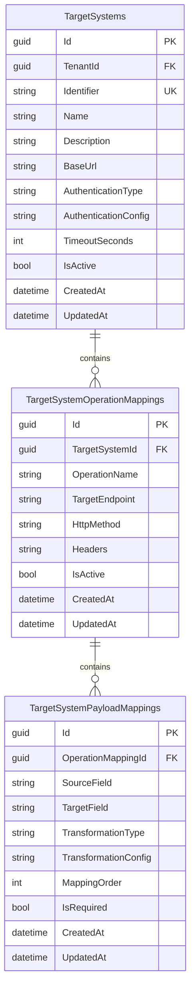
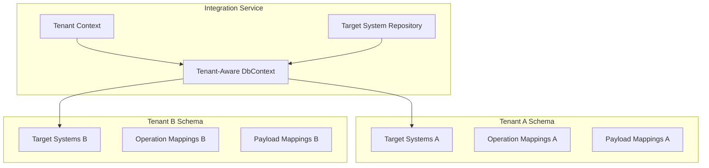
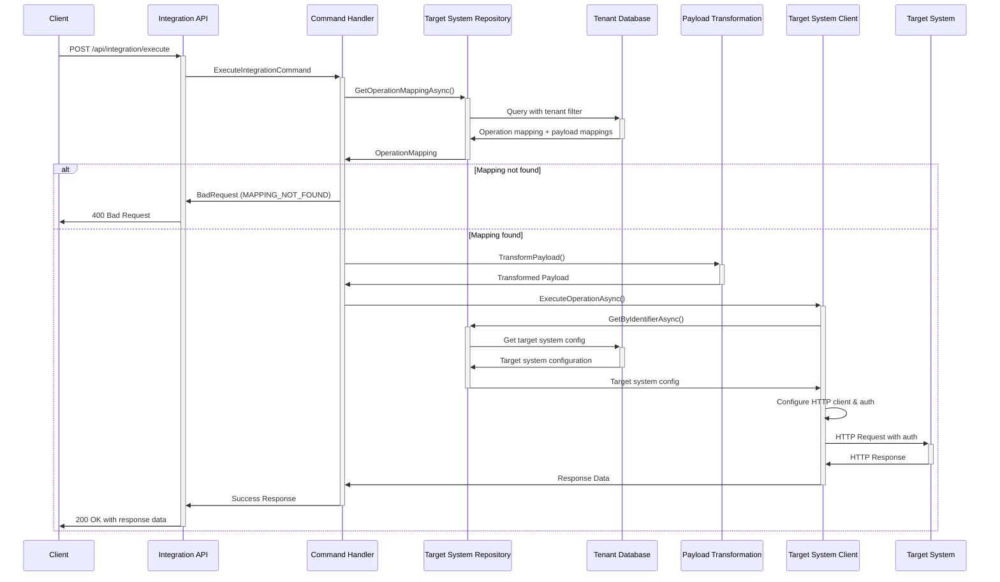

# Target System Configuration with Tenant Separation

## Overview

The Integration Service now supports configurable target system information stored in a database with tenant-by-schema separation. This approach eliminates hardcoded target system configurations and provides a flexible, multi-tenant solution.

## Architecture

### Database Schema



### Multi-Tenancy Implementation



## Entity Models

### TargetSystem Entity

```csharp
public class TargetSystem : BaseEntity<TargetSystemId>
{
    public TenantId TenantId { get; set; }
    public string Identifier { get; set; }
    public string Name { get; set; }
    public string Description { get; set; }
    public string BaseUrl { get; set; }
    public TargetSystemAuthenticationType AuthenticationType { get; set; }
    public string AuthenticationConfig { get; set; }
    public int TimeoutSeconds { get; set; }
    public bool IsActive { get; set; }
    public ICollection<TargetSystemOperationMapping> OperationMappings { get; set; }
}
```

### Authentication Types

The system supports multiple authentication mechanisms:

- **None**: No authentication required
- **ApiKey**: API key in header
- **BasicAuth**: Basic authentication with username/password
- **BearerToken**: Bearer token authentication
- **OAuth2ClientCredentials**: OAuth2 client credentials flow
- **Custom**: Custom authentication implementation

### Authentication Configuration Examples

#### API Key Authentication

```json
{
  "apiKey": "your-api-key-here",
  "headerName": "X-API-Key"
}
```

#### Basic Authentication

```json
{
  "username": "api-user",
  "password": "api-password"
}
```

#### Bearer Token Authentication

```json
{
  "token": "your-bearer-token-here"
}
```

## Integration Flow with Database Configuration



## Configuration Management

### Database Setup

1. **Entity Framework Migrations**: Use EF Core migrations to create and update the database schema
2. **Tenant Schema Separation**: Each tenant gets their own schema with isolated data
3. **Seed Data**: Configure initial target systems and mappings through data seeding

### Target System Configuration

#### Create Target System

```csharp
var targetSystem = new TargetSystem
{
    Id = new TargetSystemId(Guid.NewGuid()),
    TenantId = currentTenantId,
    Identifier = "crm-system",
    Name = "CRM System",
    Description = "Customer Relationship Management System",
    BaseUrl = "https://api.crm-system.com",
    AuthenticationType = TargetSystemAuthenticationType.ApiKey,
    AuthenticationConfig = JsonSerializer.Serialize(new {
        apiKey = "secret-api-key",
        headerName = "X-API-Key"
    }),
    TimeoutSeconds = 120,
    IsActive = true
};
```

#### Create Operation Mapping

```csharp
var operationMapping = new TargetSystemOperationMapping
{
    Id = new TargetSystemOperationMappingId(Guid.NewGuid()),
    TargetSystemId = targetSystem.Id,
    OperationName = "create-customer",
    TargetEndpoint = "/api/v1/customers",
    HttpMethod = "POST",
    Headers = JsonSerializer.Serialize(new Dictionary<string, string>
    {
        ["Content-Type"] = "application/json",
        ["Accept"] = "application/json"
    }),
    IsActive = true
};
```

#### Create Payload Mappings

```csharp
var payloadMappings = new[]
{
    new TargetSystemPayloadMapping
    {
        Id = new TargetSystemPayloadMappingId(Guid.NewGuid()),
        OperationMappingId = operationMapping.Id,
        SourceField = "firstName",
        TargetField = "first_name",
        TransformationType = "string",
        MappingOrder = 1,
        IsRequired = true
    },
    new TargetSystemPayloadMapping
    {
        Id = new TargetSystemPayloadMappingId(Guid.NewGuid()),
        OperationMappingId = operationMapping.Id,
        SourceField = "birthDate",
        TargetField = "birth_date",
        TransformationType = "datetime",
        TransformationConfig = "yyyy-MM-dd",
        MappingOrder = 2,
        IsRequired = false
    }
};
```

## Service Registration

### Updated Dependency Injection

```csharp
public static IServiceCollection AddIntegrationServices(
    this IServiceCollection services,
    IConfiguration configuration)
{
    // Register database context with tenant awareness
    services.AddDbContext<IntegrationServiceDbContext>(options =>
    {
        options.UseSqlServer(configuration.GetConnectionString("DefaultConnection"));
    });

    // Register tenant-aware context factory
    services.AddScoped<IIntegrationServiceDbContext>(provider =>
    {
        var tenantId = provider.GetRequiredService<ITenantContextResolver>().GetCurrentTenantId();
        return new IntegrationServiceDbContext(
            provider.GetRequiredService<DbContextOptions<IntegrationServiceDbContext>>(),
            tenantId);
    });

    // Register repositories
    services.AddScoped<ITargetSystemRepository, TargetSystemRepository>();

    // Register database-based services
    services.AddScoped<IMappingService, DatabaseMappingService>();
    services.AddScoped<IPayloadTransformationService, PayloadTransformationService>();
    services.AddScoped<ITargetSystemClient, DatabaseTargetSystemClient>();

    return services;
}
```

## Administration & Management

### Target System Management API

Consider creating administrative endpoints for managing target systems:

```csharp
// GET /api/admin/target-systems
// POST /api/admin/target-systems
// PUT /api/admin/target-systems/{id}
// DELETE /api/admin/target-systems/{id}

// GET /api/admin/target-systems/{id}/operations
// POST /api/admin/target-systems/{id}/operations
// PUT /api/admin/target-systems/{id}/operations/{operationId}
```

### Configuration UI

A management interface could include:

1. **Target System Management**: CRUD operations for target systems
2. **Operation Mapping Editor**: Visual editor for operation mappings
3. **Payload Transformation Designer**: Drag-and-drop field mapping
4. **Authentication Configuration**: Secure forms for auth setup
5. **Testing Tools**: Test integration operations directly from UI

## Security Considerations

### Authentication Configuration Storage

- **Encryption**: Encrypt sensitive authentication data at rest
- **Key Management**: Use secure key management for encryption keys
- **Access Control**: Restrict access to authentication configurations
- **Audit Logging**: Log all changes to target system configurations

### Tenant Isolation

- **Schema Separation**: Each tenant's data is in a separate schema
- **Query Filtering**: Automatic tenant filtering on all queries
- **Cross-Tenant Protection**: Prevent accidental cross-tenant data access
- **Connection String Security**: Secure database connection strings

## Performance Optimization

### Caching Strategy

```csharp
// Cache target system configurations
services.AddMemoryCache();
services.Decorate<ITargetSystemRepository, CachedTargetSystemRepository>();

// Cache operation mappings
services.AddDistributedMemoryCache();
```

### Database Optimization

- **Indexing**: Strategic indexes on tenant_id, identifier, and operation_name
- **Connection Pooling**: Efficient database connection management
- **Read Replicas**: Use read replicas for query-heavy operations
- **Partitioning**: Consider table partitioning for large datasets

## Migration from External Mapping Service

If migrating from an external mapping service:

1. **Data Migration**: Export existing mappings and import to database
2. **Gradual Rollout**: Use feature flags to switch between services
3. **Validation**: Compare results between old and new implementations
4. **Rollback Plan**: Maintain ability to rollback to external service

## Monitoring & Observability

### Metrics to Track

- Target system response times
- Integration success/failure rates per tenant
- Authentication failures
- Payload transformation errors
- Database query performance

### Logging Strategy

```csharp
logger.LogInformation("Target system {TargetSystem} configured for tenant {TenantId}",
    targetSystemId, tenantId);
logger.LogWarning("Authentication failed for target system {TargetSystem}",
    targetSystemId);
logger.LogError(ex, "Database error retrieving target system configuration");
```

## Benefits of Database-Driven Configuration

1. **Flexibility**: Runtime configuration changes without code deployment
2. **Tenant Isolation**: Complete separation of tenant configurations
3. **Scalability**: Database-driven approach scales with tenant growth
4. **Auditability**: Track all configuration changes
5. **Performance**: Local database queries vs external service calls
6. **Reliability**: Reduced external dependencies
7. **Security**: Centralized security and encryption management
