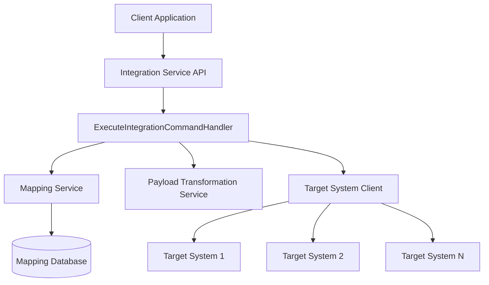
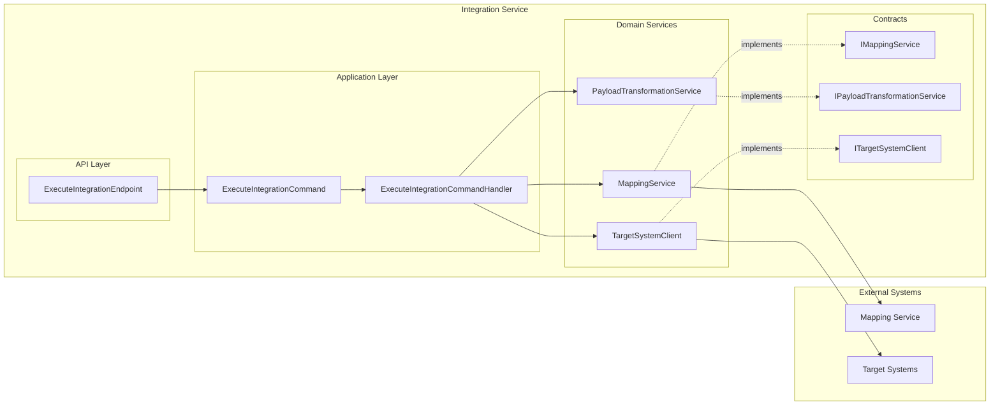
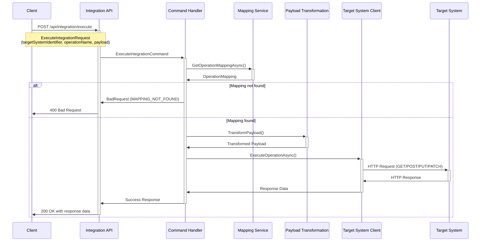
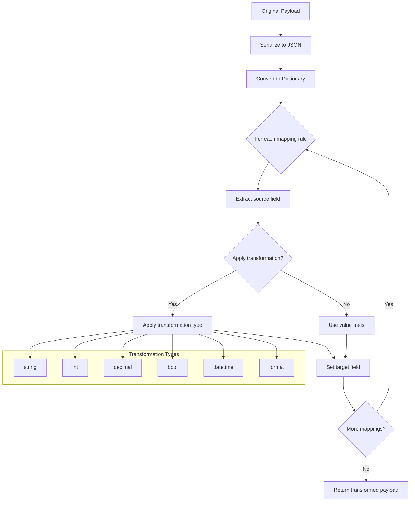
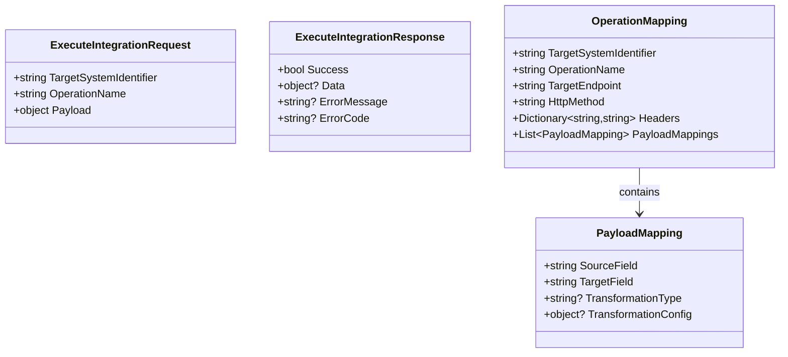

# Integration Service Technical Documentation

## Overview

The Integration Service provides a standardized way to execute operations against external target systems. It handles the complete flow from receiving integration requests to executing operations on target systems, including payload transformation and mapping retrieval.

## Architecture

### High-Level Architecture



### Component Diagram



## Process Flow

### Integration Execution Flow



### Payload Transformation Process



## Data Models

### Core Models



## Configuration

### Service Registration

```csharp
// In Program.cs or Startup.cs
builder.Services.AddIntegrationServices(builder.Configuration);

// In endpoint mapping
app.MapIntegrationEndpoints();
```

### Application Settings

```json
{
  "MappingService": {
    "BaseUrl": "https://mapping-service.example.com"
  },
  "Logging": {
    "LogLevel": {
      "Processity.IntegrationService": "Information"
    }
  }
}
```

### HTTP Client Configuration

The service automatically configures HTTP clients:

- **MappingService**: For communicating with the mapping service
- **TargetSystemDefault**: Default configuration for target systems

Additional target system-specific clients can be configured:

```csharp
services.AddHttpClient("TargetSystem_CRM", client =>
{
    client.BaseAddress = new Uri("https://crm-api.example.com");
    client.Timeout = TimeSpan.FromMinutes(2);
    client.DefaultRequestHeaders.Add("API-Key", "your-api-key");
});
```

## API Reference

### Execute Integration Endpoint

**Endpoint:** `POST /api/integration/execute`

**Request Body:**

```json
{
  "targetSystemIdentifier": "string",
  "operationName": "string",
  "payload": {}
}
```

**Response Body:**

```json
{
  "success": true,
  "data": {},
  "errorMessage": "string",
  "errorCode": "string"
}
```

**Status Codes:**

- `200 OK`: Operation executed successfully
- `400 Bad Request`: Invalid request or mapping not found
- `500 Internal Server Error`: System error during execution

## Mapping Service Contract

The integration service expects the mapping service to implement:

### Get Operation Mapping

**Endpoint:** `GET /api/mappings/{targetSystemIdentifier}/{operationName}`

**Response:**

```json
{
  "targetSystemIdentifier": "crm-system",
  "operationName": "create-customer",
  "targetEndpoint": "https://crm-api.example.com/customers",
  "httpMethod": "POST",
  "headers": {
    "Content-Type": "application/json",
    "Authorization": "Bearer {token}"
  },
  "payloadMappings": [
    {
      "sourceField": "firstName",
      "targetField": "first_name",
      "transformationType": "string"
    },
    {
      "sourceField": "birthDate",
      "targetField": "birth_date",
      "transformationType": "datetime",
      "transformationConfig": "yyyy-MM-dd"
    },
    {
      "sourceField": "phone",
      "targetField": "phone_number",
      "transformationType": "format",
      "transformationConfig": "({0})"
    }
  ]
}
```

## Payload Transformation

### Supported Transformation Types

| Type       | Description             | Configuration Example     |
| ---------- | ----------------------- | ------------------------- |
| `string`   | Convert to string       | N/A                       |
| `int`      | Convert to integer      | N/A                       |
| `decimal`  | Convert to decimal      | N/A                       |
| `bool`     | Convert to boolean      | N/A                       |
| `datetime` | Convert to DateTime     | `"yyyy-MM-dd"` (format)   |
| `format`   | Apply string formatting | `"({0})"` (format string) |

### Transformation Examples

```json
{
  "payloadMappings": [
    {
      "sourceField": "age",
      "targetField": "customer_age",
      "transformationType": "int"
    },
    {
      "sourceField": "registrationDate",
      "targetField": "reg_date",
      "transformationType": "datetime",
      "transformationConfig": "yyyy-MM-dd"
    },
    {
      "sourceField": "phoneNumber",
      "targetField": "formatted_phone",
      "transformationType": "format",
      "transformationConfig": "+1-{0}"
    }
  ]
}
```

## Usage Examples

### Basic Integration Request

```csharp
var request = new ExecuteIntegrationRequest(
    TargetSystemIdentifier: "crm-system",
    OperationName: "create-customer",
    Payload: new
    {
        firstName = "John",
        lastName = "Doe",
        email = "john.doe@example.com",
        birthDate = "1990-05-15",
        phone = "555-0123"
    }
);

// HTTP POST to /api/integration/execute
```

### Using HTTP Client

```csharp
using var httpClient = new HttpClient();
var request = new ExecuteIntegrationRequest(
    "crm-system",
    "create-customer",
    customerData);

var response = await httpClient.PostAsJsonAsync(
    "https://integration-service.example.com/api/integration/execute",
    request);

var result = await response.Content.ReadFromJsonAsync<ExecuteIntegrationResponse>();
```

## Error Handling

### Error Response Format

```json
{
  "success": false,
  "data": null,
  "errorMessage": "Detailed error description",
  "errorCode": "ERROR_CODE"
}
```

### Common Error Codes

| Code                   | Description                            | HTTP Status |
| ---------------------- | -------------------------------------- | ----------- |
| `MAPPING_NOT_FOUND`    | No mapping configuration found         | 400         |
| `TRANSFORMATION_ERROR` | Error during payload transformation    | 500         |
| `TARGET_SYSTEM_ERROR`  | Error communicating with target system | 500         |
| `INVALID_REQUEST`      | Invalid request format                 | 400         |

## Logging

The service provides comprehensive logging at different levels:

```csharp
// Information level
logger.LogInformation("Executing integration operation {OperationName} for target system {TargetSystem}");

// Warning level
logger.LogWarning("No mapping found for target system {TargetSystem} and operation {OperationName}");

// Error level
logger.LogError(ex, "Error executing integration operation {OperationName} for target system {TargetSystem}");

// Debug level
logger.LogDebug("Payload transformed for target system {TargetSystem}");
```

## Security Considerations

### Authentication

- Target system authentication is handled through HTTP headers in the mapping configuration
- Consider implementing token refresh mechanisms for OAuth scenarios

### Authorization

- Implement API key validation for the integration service endpoints
- Consider role-based access control for different target systems

### Data Protection

- Sensitive data in payloads should be encrypted in transit
- Consider implementing payload sanitization for logging

## Performance Considerations

### HTTP Client Configuration

- Connection pooling is handled automatically by `IHttpClientFactory`
- Configure appropriate timeouts for different target systems
- Consider implementing circuit breaker patterns for resilience

### Caching

- Consider caching mapping configurations to reduce calls to the mapping service
- Implement cache invalidation strategies

### Monitoring

- Add metrics for integration success/failure rates
- Monitor response times for target systems
- Track payload transformation performance

## Extensibility

### Custom Transformations

Extend the `PayloadTransformationService` to support additional transformation types:

```csharp
private object ApplyTransformation(object value, string? transformationType, object? transformationConfig)
{
    return transformationType?.ToLowerInvariant() switch
    {
        "string" => value?.ToString() ?? string.Empty,
        "custom-hash" => ComputeCustomHash(value),
        // Add new transformation types here
        _ => value
    };
}
```

### Custom Target System Clients

Implement specialized clients for specific target systems by extending `ITargetSystemClient`.

### Plugin Architecture

Consider implementing a plugin system for target system-specific logic and authentication strategies.

## Testing

### Unit Testing

- Mock `IMappingService`, `IPayloadTransformationService`, and `ITargetSystemClient`
- Test transformation logic with various payload types
- Test error handling scenarios

### Integration Testing

- Test end-to-end flows with real mapping service
- Test with various target system configurations
- Validate payload transformations with real data

### Load Testing

- Test service performance under high load
- Validate HTTP client pool behavior
- Monitor memory usage during sustained operations
