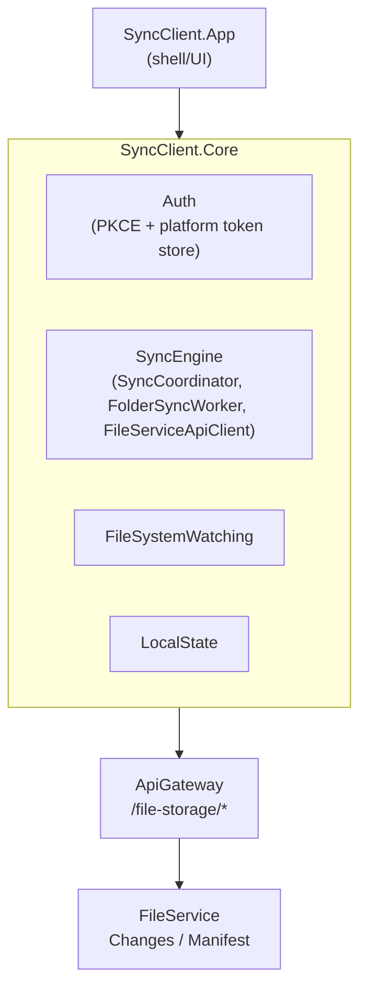

# Sync Client Architecture

## Overview

The Sync Client is Processity Drive's desktop app (product name "Processity
Drive" — see the packaging step's `--packTitle "Processity Drive"`): a
local-folder sync engine, akin to the OneDrive/Google Drive desktop
clients, that keeps a folder on disk in sync with
[FileService](../fileservice/architecture.md) via its Changes/Manifest
delta API.

.NET, split into `SyncClient.Core` (Auth, SyncEngine, FileSystemWatching,
LocalState, Updates, Diagnostics, Settings) and `SyncClient.App` (the
shell — `net10.0-windows` on Windows, `net10.0` on macOS).

---

## Auth flow

PKCE-based flow (`PkceGenerator`), supporting both password and
passkey/device-credential auth (`AuthMethod`). Tokens are kept in a
platform-native secure store, not a plain file:

- Windows: `WindowsDpapiTokenStore`
- macOS: `MacKeychainTokenStore`

Device linking goes through a dedicated `DeviceLink` flow. See
[Authentication Architecture](../authentication/architecture.md) for the
underlying RS256/JWKS cookie model the Sync Client's tokens are part of.

### Refresh-token race fix

Multiple concurrent sync workers can each hit a 401 around the same time
and try to refresh in parallel — since refresh tokens are one-time-use,
a naive implementation would have the second refresh attempt fail (the
first already redeemed the token). `TokenRefreshCoordinator` fixes this
by deduplicating concurrent refreshes: an in-flight `Task<bool>` guarded
by a `lock`, shared across every `AuthenticatedHttpMessageHandler`/sync
worker, so only one refresh actually happens per expiry and the rest
await its result instead of racing it.

---

## Sync engine

- `SyncCoordinator` — top-level orchestration
- `FolderSyncWorker` — per-folder sync loop
- `FileServiceApiClient` / `FileServiceDtos` — talks to FileService's
  Changes/Manifest endpoints (see
  [FileService Architecture](../fileservice/architecture.md#sync-delta-feed))
- `OfficeFormats` — handles Office/WOPI-editable file types specially
- `IgnoredPaths` — sync exclusion rules

---

## Packaging & code signing

CI (`.github/workflows`) builds and packages via `vpk pack`:

- **Windows**: Authenticode-signed (`signtool` via `vpk pack
  --signParams`, using `WINDOWS_CERT_PFX_BASE64`/`WINDOWS_CERT_PASSWORD`
  CI secrets).
- **macOS** (arm64/x64): **unsigned, unnotarized** — no Apple Developer ID
  available yet. Known gap; flag before wider macOS rollout.

## Related components

- [FileService Architecture](../fileservice/architecture.md) — the API this client syncs against
- [Authentication Architecture](../authentication/architecture.md) — token/cookie model behind the PKCE flow
