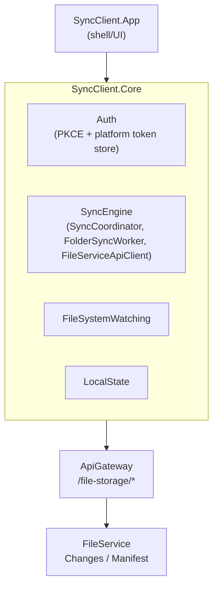
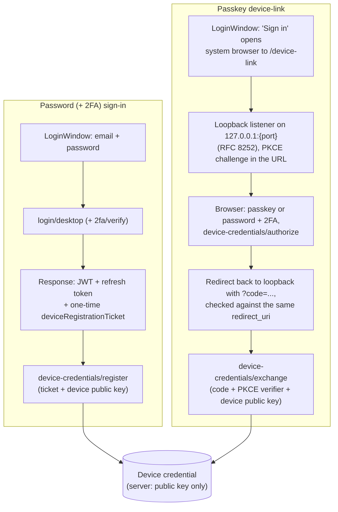

# Sync Client Architecture

## Overview

The Sync Client is Processity Drive's desktop app (product name "Processity
Drive" — see the packaging step's `--packTitle "Processity Drive"`): a
local-folder sync engine, akin to the OneDrive/Google Drive desktop
clients, that keeps a folder on disk in sync with
[FileService](../fileservice/architecture.md) via its Changes/Manifest
delta API.

.NET, split into `SyncClient.Core` (Auth, SyncEngine, FileSystemWatching,
LocalState, Updates, Diagnostics, Settings) and `SyncClient.App` (the
shell — `net10.0-windows` on Windows, `net10.0` on macOS).

---

## Auth flow

The Sync Client supports two ways to sign in, both ending in the same
place: a long-lived **device credential** (an ECDSA P-256 keypair) that
lets the app silently renew its access token without the user present.
See [Authentication Architecture](../authentication/architecture.md) for
the underlying RS256/JWKS cookie model the access token itself is part
of.

Tokens and the device's private key are kept in a platform-native secure
store, never a plain file:

- Windows: `WindowsDpapiTokenStore` (token) / `WindowsDeviceKeyStore`
  (non-exportable CNG key, TPM-backed where available)
- macOS: `MacKeychainTokenStore` (token) / `MacKeychainDeviceKeyStore`
  (PKCS8 key material) — both via `MacSecurityCli`, which shells out to
  `/usr/bin/security` with every secret passed over **stdin**, never
  argv (another local process can read another user's command line on
  macOS). `security -i` caps an input line at 4095 characters, so
  `MacKeychainTokenStore` splits a token larger than that across several
  keychain items and swaps generations atomically, so a concurrent read
  never observes a half-written token.

### Device linking (passkey)

`DeviceLinkService` drives a loopback-redirect flow (RFC 8252 §7.3)
instead of a custom URI scheme: opens the system browser at the web
app's `/device-link` page with a PKCE challenge and a freshly bound
`redirect_uri` of `http://127.0.0.1:{port}/`, then listens on that port
for the callback. The server (`DeviceCredentialController.Authorize`)
records the `redirect_uri` alongside the PKCE challenge and
(`LoopbackRedirectUri`) refuses anything that isn't a loopback address —
otherwise a crafted link could have the code delivered to an
attacker-controlled host instead. `Exchange` requires the same
`redirect_uri` back, so a code can only be redeemed by the client it was
issued to.

### Device registration (password login)

A password (+2FA) login alone is not enough to register a device
credential: `login/desktop` and its 2FA-verify step each return a
one-time `deviceRegistrationTicket` (5-minute TTL), and
`device-credentials/register` requires it, matched to the same user and
tenant. This stops a merely stolen short-lived access token from being
upgraded into a credential that survives for months — registration
requires having just completed a fresh primary login, not just holding
a session.

### Revocation

Removing an account, or re-authenticating one, now revokes its device
credential server-side (`AuthApiClient.RevokeDeviceCredentialAsync`,
proved by signing a fresh challenge — works even once the access token
has expired) before deleting the local key and clearing the stored
token (`DeviceUnlinker`). A password reset (the forgot-password email
link) revokes **every** device credential and refresh token the user
has, across every tenant — since that flow exists specifically to
recover a compromised account.

### Refresh-token race fix

Multiple concurrent sync workers can each hit a 401 around the same time
and try to refresh in parallel — since refresh tokens are one-time-use,
a naive implementation would have the second refresh attempt fail (the
first already redeemed the token). `TokenRefreshCoordinator` fixes this
by deduplicating concurrent refreshes: an in-flight `Task<bool>` guarded
by a `lock`, shared across every `AuthenticatedHttpMessageHandler`/sync
worker, so only one refresh actually happens per expiry and the rest
await its result instead of racing it.

---

## Sync engine

- `SyncCoordinator` — top-level orchestration
- `FolderSyncWorker` — per-folder sync loop
- `FileServiceApiClient` / `FileServiceDtos` — talks to FileService's
  Changes/Manifest endpoints (see
  [FileService Architecture](../fileservice/architecture.md#sync-delta-feed))
- `OfficeFormats` — handles Office/WOPI-editable file types specially
- `IgnoredPaths` — sync exclusion rules

---

## Packaging & code signing

CI (`.github/workflows`) builds and packages via `vpk pack`:

- **Windows**: Authenticode-signed (`signtool` via `vpk pack
  --signParams`, using `WINDOWS_CERT_PFX_BASE64`/`WINDOWS_CERT_PASSWORD`
  CI secrets).
- **macOS** (arm64/x64): **unsigned, unnotarized** — no Apple Developer ID
  available yet. Known gap; flag before wider macOS rollout. The same gap
  means the macOS device key isn't Secure Enclave-bound and the Keychain
  ACL trusts `/usr/bin/security`, so any other process running as the
  same user can read these items without a prompt — both need a signed
  app with Keychain entitlements to fix properly.

## Related components

- [FileService Architecture](../fileservice/architecture.md) — the API this client syncs against
- [Authentication Architecture](../authentication/architecture.md) — token/cookie model behind the PKCE flow
