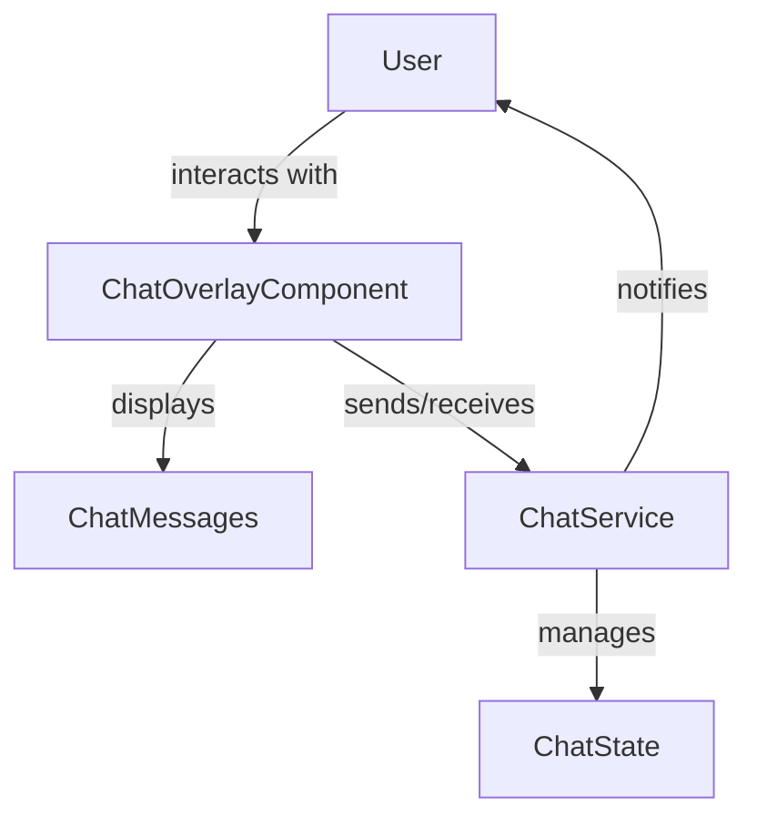

# Chat Components and Services Documentation

## Overview

This document describes the chat-related components and services in the application, focusing on their responsibilities, dependencies, usage, and potential pitfalls.

---

## Functional Relationships (Mermaid Diagram)



---

## Components

### `ChatOverlayComponent`

**Location:** `src/app/shared/components/chat-overlay/chat-overlay.component.ts`

#### Responsibilities

- Renders the chat overlay UI, allowing users to interact with chat features.
- Displays chat messages, input fields, and controls for sending/receiving messages.
- Handles visibility based on the chat service's state.

#### Dependencies

- `ChatService`: Provides observables for chat visibility, connection status, and unread messages.
- Angular core and common modules for rendering and change detection.

#### Usage

- Used in the root component template:
  ```html
  <app-chat-overlay *ngIf="showChat$ | async"></app-chat-overlay>
  ```
- Visibility is controlled by the `showChat$` observable from `ChatService`.

#### Pitfalls

- Ensure the component is only rendered when the chat service is available and initialized.
- Subscriptions to observables should be properly managed to avoid memory leaks.

---

## Services

### `ChatService`

**Location:** `src/app/shared/services/chat/chat.service.ts`

#### Responsibilities

- Manages chat state, including connection status and unread messages.
- Provides observables:
  - `isVisible$`: Whether the chat overlay should be shown.
  - `connectionEstablished$`: Emits when the chat connection is established.
  - `unreadMessages$`: Emits the count or status of unread messages.
- Handles chat-related business logic and communication with backend or WebSocket APIs.

#### Dependencies

- May depend on HTTP/WebSocket services for real-time communication.
- Can depend on user/session services for authentication and user context.

#### Usage

- Injected into components (e.g., `AppComponent`, `ChatOverlayComponent`) to control chat UI and state.
- Example:
  ```typescript
  constructor(private chatService: ChatService) {}
  ngOnInit() {
    this.chatService.connectionEstablished$.subscribe();
    this.chatService.unreadMessages$.subscribe();
  }
  ```

#### Pitfalls

- Ensure subscriptions are unsubscribed on component destroy to prevent memory leaks.
- Handle connection errors and reconnection logic gracefully.
- Avoid exposing sensitive user data through chat messages or logs.

---

## Example Integration

In `AppComponent`:

```typescript
showChat$ = this.chatService.isVisible$;
...
<app-chat-overlay *ngIf="showChat$ | async"></app-chat-overlay>
```

---

## Best Practices

- Use Angular's `async` pipe in templates to manage subscriptions automatically.
- Centralize chat state in `ChatService` to avoid duplicated logic.
- Validate and sanitize all chat input/output to prevent XSS or injection attacks.
- Test chat UI and service logic for edge cases, such as network interruptions.

---

## Summary

The chat overlay and service are designed to provide a modular, observable-driven chat experience. Proper management of observables and dependencies is crucial for performance and maintainability. Always follow Angular best practices for dependency injection and subscription management.
